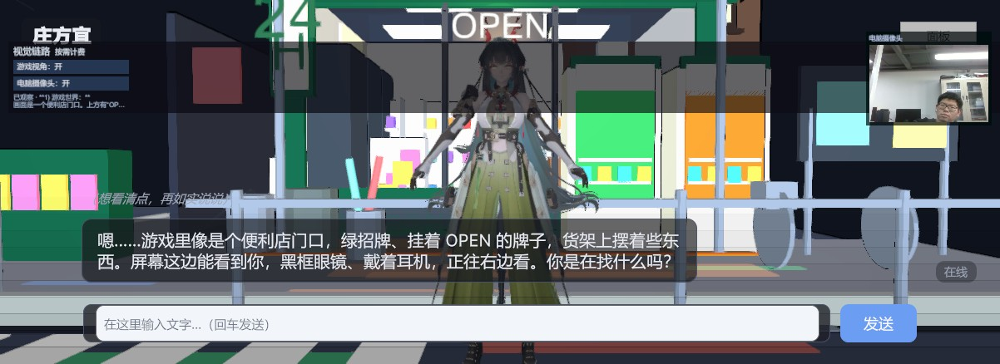
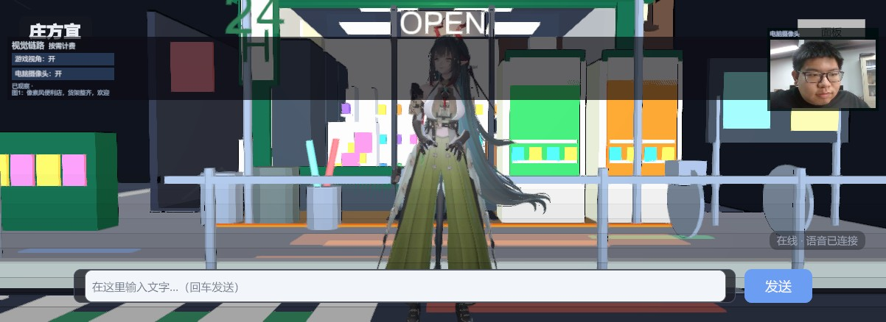
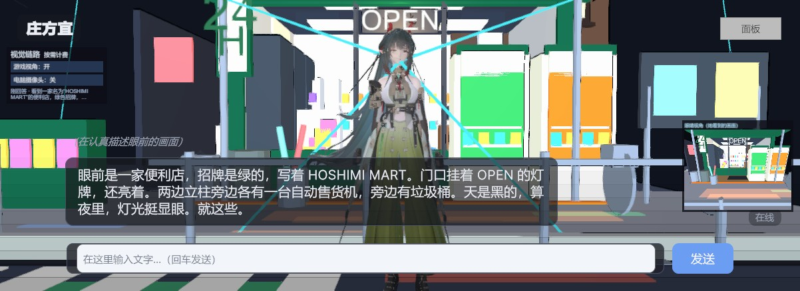

> **配套地图生成器项目：[MapGen Engine →](https://github.com/wbcyyds123321/-MapGen)**

# 虚拟数字人 / AI Character Interaction System

一个跑在 Unity 3D 场景里的 AI 数字人原型：能听、能说、能看当前画面，能在场景里走动、做动作、选择物体，并把自然语言请求落成真实可验证的 Unity 行为。项目同时包含程序化城市/街区地图生成工具链。

> 毕业设计（进行中）。当前是**阶段性源码开源**，不是封装好的可安装应用或完整游戏工程。

- 演示视频：https://space.bilibili.com/503297296
- 项目仓库：https://github.com/wbcyyds123321/digital-human
- 本次阶段说明：[docs/progress-2026-11-11.md](docs/progress-2026-11-11.md)

<p align="center">
  
</p>

<p align="center"><i>Unity 大地图里的数字人：场景、第三人称相机、角色表现与运行时交互在同一套系统里。</i></p>

---

## 项目状态：阶段性源码开源

**当前仓库只包含源码和架构文档，不是已经封装的完整 Unity 工程。**

- 不含角色 VRM/MMD 模型、美术贴图、动画资产、地图 GLB/BLEND/渲染图、音频和第三方 Unity 包；
- 不含 `Library/`、`Temp/`、`Logs/`、`Captures/`、内部 AI 工作记录、本机缓存或任何 API Key；
- 运行前需要自行准备 Unity 工程、依赖包、角色/地图资产和 API 配置；
- 代码与实验仍在变化，接口和行为以仓库当前源码为准。

## 目前已经打通的能力

- **对话与任务**：自然语言 → 意图/任务契约 → Lua 任务程序 → Unity 工具执行 → 真实回执；行动和对话分车道，支持边走边说、打断、暂停和插入-继续。
- **第一人称画面选中**：当前 EyeCamera 原始 RGB → 视觉模型输出归一化点/框 → 同帧实体 ID/depth 绑定 → 真实转动 Eye → 新帧中心确认 → 共享选中记录、高亮和坐标事实。视觉输入只有原图，不包含 ID 图、候选 overlay、目录位置或答案。
- **当前验证范围**：白色选中实验室 B1–B6 六个普通语义用例通过，包括红方块、同色绿方块的当前画面左右区分、代词追问零新增定位、被遮挡球 `not_found`、第二视点蓝球、蓝球左侧黄色圆柱；相对方位语义有生产转换边界保护和否定/后置否定检查。
- **视觉服务**：产品默认使用 DeepSeek 官方兼容接口、`deepseek-flash` 单模型、单张原图、无跨服务 fallback；保留原始响应/HTTP/耗时/诊断。不可用或配额失败会如实记录 blocked，不循环重试。
- **白色选中实验室**：独立白盒场景，7 个显式稳定 ID 实例、两个同模绿色方块、白色不透明屏风、准星、高亮、坐标和顶视小地图；有 `A/B` 观察点与编辑器构建工具。
- **语音链路**：Unity `<->` Python voice sidecar 的 AEC/VAD/ASR/流式 TTS/口型链路；TTS 队列按 turn/service/token 隔离，支持真实 barge-in 取消、UI 输入打断和首音频确认。注入 WAV、ASR、TTS 生命周期的受控验证已覆盖；真人麦克风/口音/噪声/回声仍待实测。
- **场景交互模块**：`Stage4` 座椅坐下/起身、`Stage5` 视觉座椅选择、`Dynamic` 车辆/电车/动态实体与驾驶/交互入口、`WorldMap` 大地图数据/导航 provider。README 不把这些“代码链路存在”冒充为最新一轮全量回归；完整驾驶、座椅、上下车和复杂地图识别仍需单独验收。
- **地图生成**：程序化苏联蓝调街区工具链：2D 规划 → GPT-Image/参考图 → Blender 模块化生成 → GLB → 碰撞 AABB/导航图/中文锚点/地面高度图。详见 [map/README.md](map/README.md)。

## 效果预览

### 1. 数字人 HUD：地图、任务、角色、视觉、语音在一个控制台

<p align="center">
  
  
</p>

### 2. 边走边说：地图点选目的地，角色一边走一边对话

<p align="center">
  
</p>

### 3. 摄像头看用户，以及 Unity 相机看游戏世界

<p align="center">
  
  
  
</p>

## 快速打开白色选中实验室

1. 用 Unity 2022.3 打开一个完整工程，确认所需第三方包/角色/地图资产就绪。
2. 在完整工程中使用 `Assets/Editor/SelectionLab/SelectionLabBuilder.cs` 的菜单构建/接入白盒场景（本仓库只含源码，不附带场景和模型资产）。
3. 进入 Play；默认观察点 A，`1`/`2` 在提交前切换 A/B 观察点，鼠标手动转视角。
4. 在聊天框输入类似：`选中眼前的红色方块，告诉我它和我的位置，别移动。`
5. `T` 是保留的人工准星确认键；自动视觉选中流程不要求按 T。

> 实验室场景为了测试隔离会关闭默认语音输入/TTS；主场景恢复常规语音行为。具体参考 `docs/progress-2026-11-11.md`。

## 核心架构

- **行动车道**：`ChatSession` → 任务契约（目标/次数/顺序/禁止项/成功条件）→ `TaskLuaRuntime` → `TaskToolRegistry` 的 `game.*` 技能 → Unity 真实回执。
- **对话车道**：独立 LLM 请求，负责聊天、进度和看图，不直接控制身体；两车道共享会话状态。
- **视觉选中**：`PickService` 的 RGB/ID/depth 同帧捕获 + `EntityPickRegistry` 稳定实体 + `FirstPersonTargetingService` 的点/框绑定、真实 Eye 转向、新帧中心确认 + `SelectionBroker` 共享事实。
- **语音**：`voice/voice_server.py` 独立 sidecar；Unity 侧通过 VoiceInputController/TaskSpeechQueue 做流式播放、打断和口型。

关键入口：

- `unity/Assets/Scripts/AI/ChatSession.cs`
- `unity/Assets/Scripts/Selection/FirstPersonTargetingService.cs`
- `unity/Assets/Scripts/Selection/PickService.cs`
- `unity/Assets/Scripts/Selection/EntityPickRegistry.cs`
- `unity/Assets/Scripts/Stage4/Stage4SeatController.cs`
- `unity/Assets/Scripts/Dynamic/DynamicActorSystem.cs`
- `voice/voice_server.py`
- `map/tools/build.py`
- `map/integration/make_unity_data.py`

## 仓库结构

```text
unity/
  Assets/Scripts/        # 运行时 C#：AI / 任务 / 导航 / 视觉 / 选中 / 语音 / UI / 角色
  Assets/Editor/         # 编辑器工具：地图迁移、场景构建、回归检查、SelectionLab
  ProjectSettings/       # 仅保留 ProjectVersion
voice/                   # Python 语音 sidecar 脚本与说明
map/
  tools/                 # Blender + Python 程序化地图生成
  integration/           # 导出 Unity 运行时数据（碰撞/导航/锚点/地面高度）
docs/
  architecture.md        # 总体技术架构
  roadmap.md             # 后续方向
  progress-2026-11-11.md # 本项目阶段进展与验收边界
  images/                # README 截图（运行时 + 地图生成结果）
```

## 建议先看

1. `docs/architecture.md`：总体架构、双车道、任务契约、数据流和指标。
2. `docs/progress-2026-11-11.md`：相对上一版公开快照的进展、已验证/未验证边界。
3. `unity/Assets/Scripts/Selection/FirstPersonTargetingService.cs` + `PickService.cs`：当前画面物体选中的真实链路。
4. `unity/Assets/Scripts/AI/ChatSession.cs` + `AI/Tasks/TaskMissionRunner.cs`：一句话如何变成可执行、可验证的任务。
5. `voice/voice_server.py`：AEC/VAD/ASR/流式 TTS/打断的 sidecar 组织方式。

## 技术栈

- Unity 2022.3.62f3c1 + URP；C#；VRM/UniGLTF/lilToon/MMD 骨骼 + 变形桥接。
- Python 3.11+ 语音 sidecar；本地 ASR、流式 TTS、AEC/VAD、口型数据。
- LLM/VLM 通过可配置 endpoint 接入；当前视觉产品链为 DeepSeek `deepseek-flash`，不把密钥写入仓库。
- Blender + Python 程序化地图生成；GLB/FBX 导出与 Unity 运行时数据生成。

## 验收边界与已知限制

- 当前源码开源不等于完整工程；缺少模型/地图/第三方包时不能直接运行。
- 视觉选中的白盒用例已验证，但不代表复杂苏联地图全场景识别准确率；真实车/椅样本是有限功能样本。
- 驾驶、座椅、上下车等模块在源码中已有链路；最新白盒轮未重跑完整回归，不能据此宣称全部场景验收完成。
- 真人麦克风、口音、环境噪声、回声、AEC 和主观听感仍 pending；录音注入/受控 TTS 事件不等于真人声学验收。
- 独立外观图审受外部服务限制，不作为本仓库当前验收承诺。

## License

源代码采用 [MIT License](LICENSE)。角色模型、贴图、音频、地图资产与第三方包不包含在本仓库内，不适用本许可证；如需使用请联系作者确认授权。
