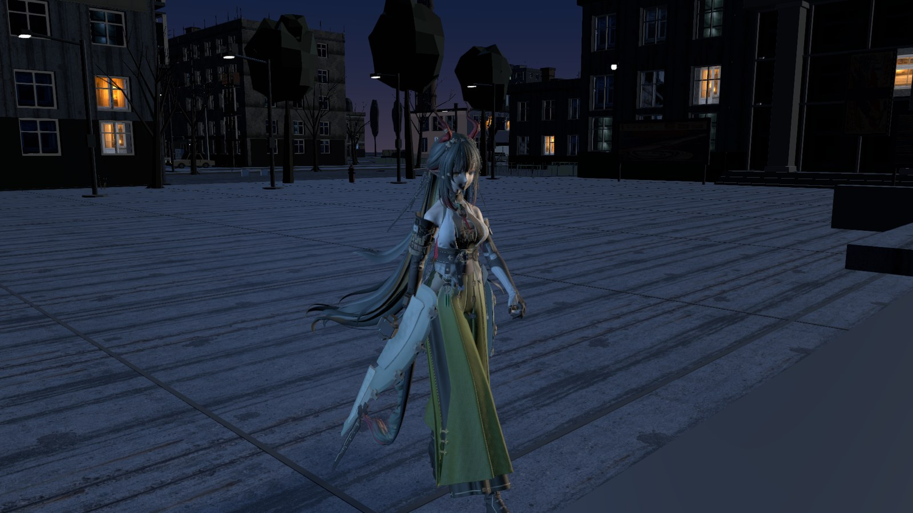
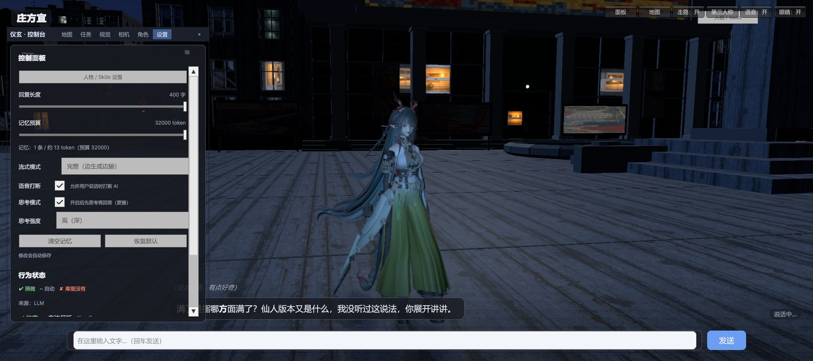
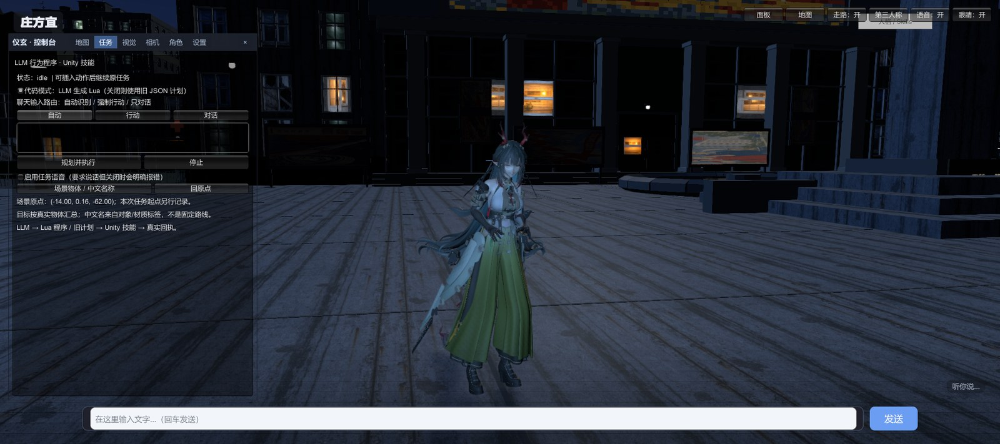
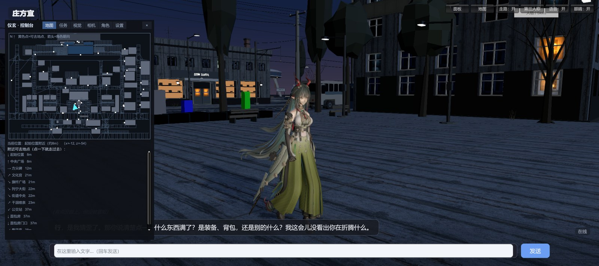
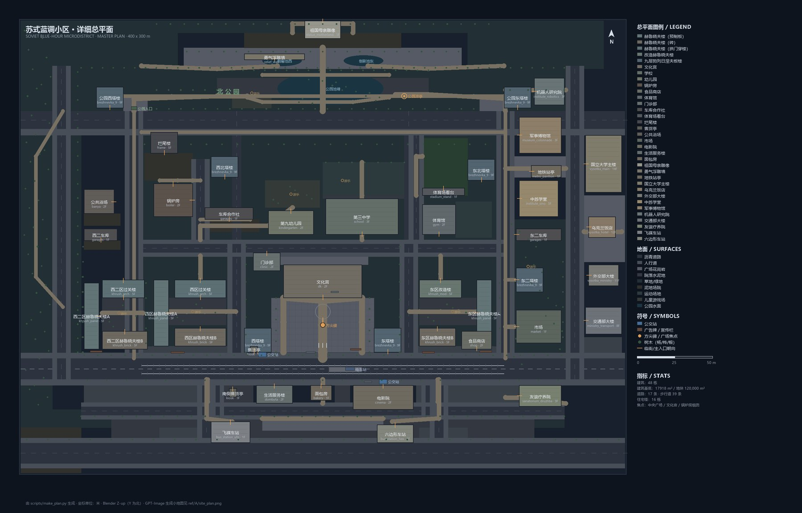
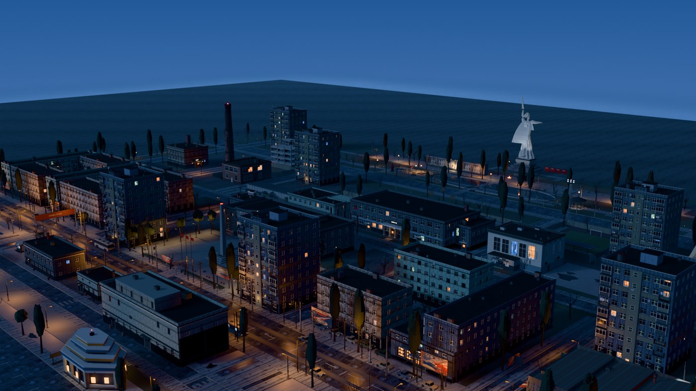
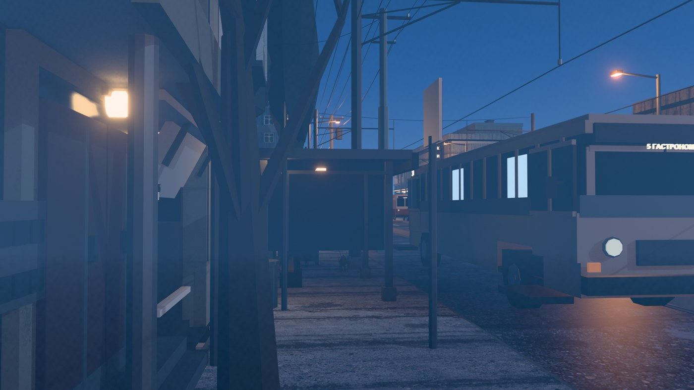

# 虚拟数字人 / AI Character Interaction System

一个跑在 Unity 3D 场景里的 AI 数字人原型：她能听懂自然语言，在场景里走过去、做动作、看用户和游戏世界，再开口回话；项目同时包含一套程序化城市地图生成工具链。

> 毕业设计（进行中）。当前已跑通**单数字人闭环**；下一步是同一张大地图里并行多个数字人、玩家可控角色进入，最终让玩家和数字人一起「造世界」。

- 演示视频：https://space.bilibili.com/503297296
- 项目仓库：https://github.com/wbcyyds123321/digital-human

<p align="center">
  
</p>

<p align="center"><i>Unity 大地图里的数字人：场景、第三人称相机、角色表现与运行时交互都在同一套系统里。</i></p>

---

## 项目状态：阶段性源码开源（不是成品游戏）

**本项目目前只是阶段性的源码开源，不是已经封装好的可安装应用或游戏。**

- 没有针对普通用户体验做任何优化；
- 后续还会继续改动，所以目前没有封装成可以直接安装、即点即用的应用包/游戏发行版；
- 现阶段主要用于代码与架构展示、审稿；
- 要运行仍需自行准备 Unity 工程、第三方依赖、角色/地图素材和 API 配置。

等后续版本稳定后，再考虑打包与发行。

---

## 效果预览

### 1. 数字人 HUD：地图、任务、角色、视觉、语音都在一个控制台里

<p align="center">
  
  
</p>

<p align="center"><i>左：地图页 + 小地图 + 点选导航；右：任务执行页（LLM 生成计划 → Unity 技能 → 真实回执）。</i></p>

### 2. 边走边说：小地图点选目的地，角色一边走一边对话

<p align="center">
  
</p>

<p align="center"><i>角色边走边聊，小地图显示当前位置、可去地点和实时导航；行动/对话双车道共享状态，所以不会因为说话把走路停掉。</i></p>

## 她现在能做什么

- **听懂并做事**：自然语言指令 → 任务契约 → Lua 任务程序 → Unity 技能执行 → 真实回执校验。
- **边走边说**：行动/对话双车道，支持打断、暂停-插入-继续；做不下去会给出明确原因（不可达 / 歧义 / 超时）。
- **看得见**：VLM 两路视觉——笔记本摄像头看用户，Unity 相机看游戏世界；当前用于对话/观察，也为后续「自己看地图、判断改造」打底。
- **说得出**：全双工语音链路（AEC / VAD / ASR + 流式 TTS + 口型同步），支持边说边听、被打断会停。
- **演得像**：15 种表情、10 种神态、16 个角色技能，VRM / MMD 骨骼 + 表情/口型/头发物理。
- **能改世界**：程序化地图工具链（2D 规划 → GPT-Image 参考图 → Blender 模块化生成 → GLB + 导航/碰撞/锚点/地面高度 + 中文名/坐标映射）。

---

## 地图生成工具链：程序化生成一座「苏联蓝调小区」

这个项目里的大地图不是手工摆出来的，而是按「先规划、再生成、最后接运行时数据」的流程做的。地图为 **400×300 m** 的苏联蓝调风格街区，包含住宅、公共文化、工业、地标四类建筑。

### 1. 先出 2D 规划

先由 `make_plan.py` 输出总平面图与 `plan.json`：道路、地块、建筑类型、朝向、地标位置先确定，再进入 Blender。

<p align="center">
  
</p>

<p align="center"><i>程序化生成的总平面图：48 栋建筑、17 条街道、39 个地块，住宅/公共/工业/地标分类和中文图例都在图里。</i></p>

### 2. 参考图定风格与比例

生成之前先用 GPT-Image 产出小地图、建筑三视图、材质、立面细节等 **104 张参考图**，再配 **52 张苏联建筑真实照片**做对照，先定风格、比例和材质，而不是直接开始堆模型。

### 3. Blender 模块化生成

`build.py` 读取 `plan.json`，调用 `mod_residential.py` / `mod_civic.py` / `mod_industrial.py` / `mod_landmark_*.py` 等模块，生成：

- **34 类建筑模块**、**48 栋建筑**、**38,454 个对象**、约 **142 万三角面**；
- 每栋建筑按「体块 → 立面 → 窗户/门/招牌 → 材质」分层生成；
- 地标单独建、单独 QA，满意后才放回地图。

<p align="center">
  
  
</p>

<p align="center"><i>左：蓝调时刻的街区鸟瞰；右：街道视角。玻璃、石材、砖墙、招牌材质都是按参考图逐项定的。</i></p>

### 4. 地标：从参考图到可进入的场景

地标同样走「独立摄影棚工作流」：先单独建模，转 4 个角度 + 正/背立面 + 近景细节，对照参考图反复迭代，满意后才放进地图。

<p align="center">
  
  
</p>

<p align="center"><i>左：祖国母亲雕像；右：国立大学主楼。雕塑、尖塔、旗帜、钟面都是可单独查看的地标物件。</i></p>

### 5. 导出给 Unity 用的运行时数据

地图生成完不是只导一个 GLB，还同时产出运行时数据：

- **91 个碰撞 AABB**：角色和相机的碰撞、避障；
- **3,486 节点 / 8,551 边导航图**：A* 寻路直接用；
- **46 个中文语义锚点**：模型/Agent 说「去面包房」时能定位到具体坐标；
- **1m 地面高度图**：角色动态贴地，广场和草地不会悬空或陷进去；
- **中文名 + 坐标映射表**：每栋建筑 / 地点一份，给 VLM 和后续 Agent 查表用，而不是让模型猜坐标。

---

## 核心架构

### 1. 行动车道 / 对话车道

- **行动车道**：`ChatSession` → 任务契约（目标、次数、顺序、禁止项、成功条件）→ `TaskLuaRuntime` 执行 Lua 程序 → `TaskToolRegistry` 里的 `game.*` 技能 → Unity 真实回执。
- **对话车道**：独立的一次 LLM 请求，只负责聊天、进度和看图，不直接控制身体。
- 两条车道共享对话状态，所以可以边走边说；模型只负责出方案，执行与完成判定交给 Unity。

关键代码：
- `unity/Assets/Scripts/AI/ChatSession.cs`
- `unity/Assets/Scripts/AI/Tasks/TaskMissionRunner.cs`
- `unity/Assets/Scripts/AI/Tasks/TaskLuaRuntime.cs`
- `unity/Assets/Scripts/AI/Tasks/TaskToolRegistry.cs`

### 2. 视觉与语音

- `QwenVisionClient` 走 OpenAI 兼容接口，支持普通问答、视频帧、取消/超时与回退模型；摄像头和 Unity 相机两个来源共用同一套视觉链路。
- `voice/voice_server.py` 是独立语音 sidecar：AEC / VAD / 本地 ASR / 流式 TTS / 打断控制；Unity 侧通过 UDP 接收口型数据。

关键代码：
- `unity/Assets/Scripts/Vision/QwenVisionClient.cs`
- `voice/voice_server.py`

### 3. 导航与地图

- 大地图模式不依赖场景里的 `Ground`：障碍来自 AABB，寻路走导航图，语义地点来自中文锚点；角色用地面高度图动态贴地。
- 地图工具链输出 GLB/FBX、碰撞 AABB、导航图、中文锚点、1m 地面高度图，以及「中文名 + 坐标」映射表，让模型/Agent 能查表说「去面包房」，而不是猜坐标。

关键代码：
- `unity/Assets/Scripts/World/WorldData.cs`
- `unity/Assets/Scripts/Motion/GroundSnap.cs`
- `map/tools/make_plan.py`
- `map/tools/build.py`
- `map/integration/make_unity_data.py`

---

## 仓库结构

```text
unity/
  Assets/Scripts/        # 运行时 C#：AI / 任务 / 导航 / 视觉 / 语音 / UI / 角色
  Assets/Editor/         # 编辑器工具：地图迁移、任务场景构建、回归检查
  ProjectSettings/       # 仅保留 ProjectVersion
voice/                   # Python 语音 sidecar（AEC / VAD / ASR / TTS / 打断）
map/
  tools/                 # Blender + Python 程序化地图生成
  integration/           # 导出 Unity 运行时数据（导航 / 碰撞 / 锚点 / 地面高度）
docs/
  architecture.md        # 项目技术总览（架构 / 数据流 / 模型 / 指标）
  roadmap.md             # 下一版方向：VLM 改地图 / 双全工语音 / Agent 注入
  images/                # README 截图（运行时 + 地图生成结果）
```

## 建议先看这些

1. `docs/architecture.md`：全局架构、双车道、任务契约、数据流和指标。
2. `unity/Assets/Scripts/AI/ChatSession.cs` 和 `AI/Tasks/TaskMissionRunner.cs`：一句话如何变成可执行、可验证的任务。
3. `unity/Assets/Scripts/AI/Tasks/TaskToolRegistry.cs`：角色技能如何注册并被 Lua 调用。
4. `voice/voice_server.py`：语音 sidecar 的 AEC / VAD / ASR / 流式 TTS 组织方式。
5. `map/tools/build.py` + `map/integration/make_unity_data.py`：地图从 2D 规划到 Unity 数据的完整链路。

## 技术栈

- Unity 2022.3.62f3c1 + URP；C#；VRM / UniGLTF / lilToon / MMD 骨骼 + 变形桥接。
- Python 3.11+ 语音 sidecar；本地 ASR、流式 TTS、AEC/VAD。
- LLM / VLM 通过可配置 endpoint 接入（规划、对话、视觉可独立换模型）。
- Blender + Python 程序化地图生成；GPT-Image 参考图；GLB/FBX 导出。

## 关于本仓库的说明

这是一个**源代码 + 架构文档**仓库，不是可直接运行的完整 Unity 工程：

- **不包含**角色 VRM / MMD 模型、美术贴图、动画资产、地图 GLB/BLEND/渲染图、模型权重、TTS 参考音频；
- **不包含**内部 agent 记录、`Logs/`、`Captures/`、本地缓存与任何 API Key；
- 第三方 Unity 包（VRM / UniGLTF / lilToon / ADB / Unity MCP 等）不在此仓库中，README 只说明依赖关系；
- 代码通过环境变量或本地配置文件读取密钥，仓库内没有任何可用的 API key；
- `docs/images/` 里的截图是项目运行/地图生成结果，用于展示效果，不代表完整工程可一键复现。

如果你需要完整工程或美术资源，请通过 GitHub / Bilibili 联系作者。

## Roadmap

- **A. 地图 VLM → 外部 Agent → 地图工具链**：数字人自己看地图、提改造方案，外挂 Agent 细化后调用工具链生成并热插拔。
- **B. 双全工语音**：全双工 + 全工具，像打电话一样边说边调工具。
- **C. Agent 生成地图 / 脚本 / 插件**：从数据级生成走到代码级注入。

详见 `docs/roadmap.md`。

## License

源代码采用 [MIT License](LICENSE)。角色模型、贴图、音频、地图资产与第三方包不在本仓库内，不适用该许可证；如需使用请联系作者确认授权。
