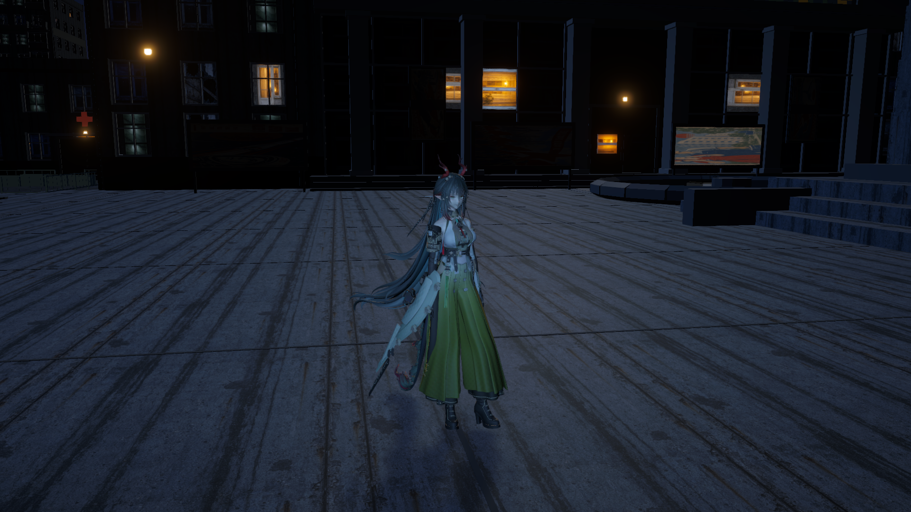
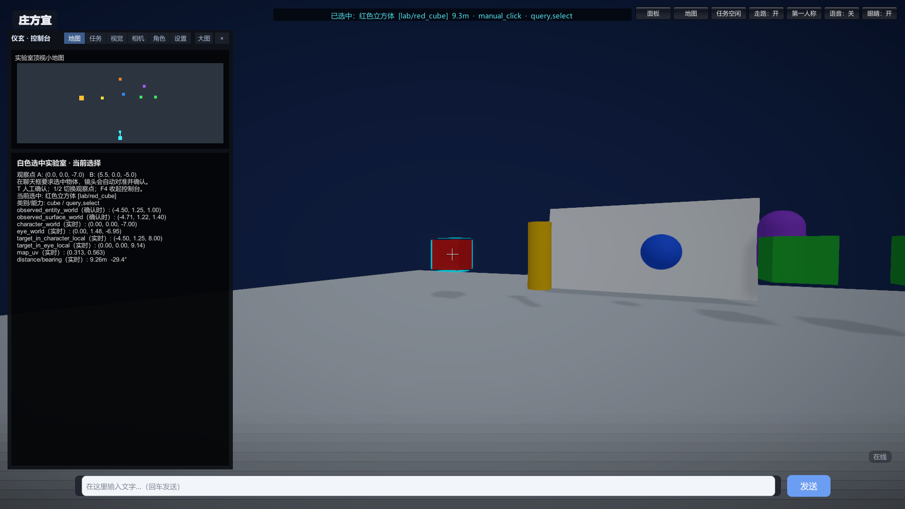
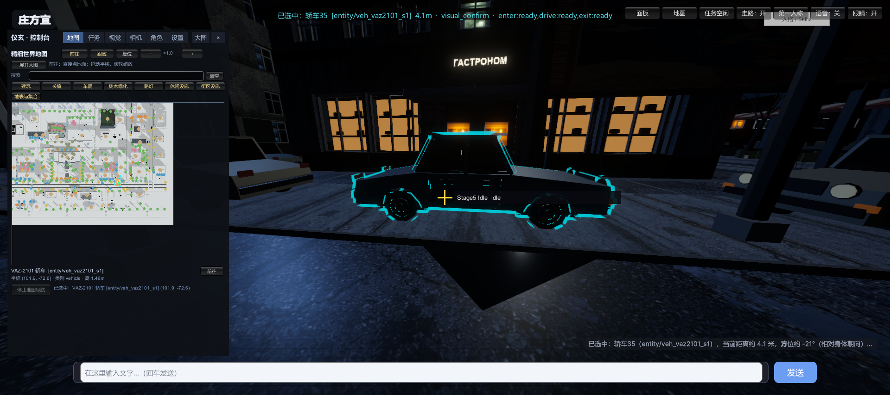
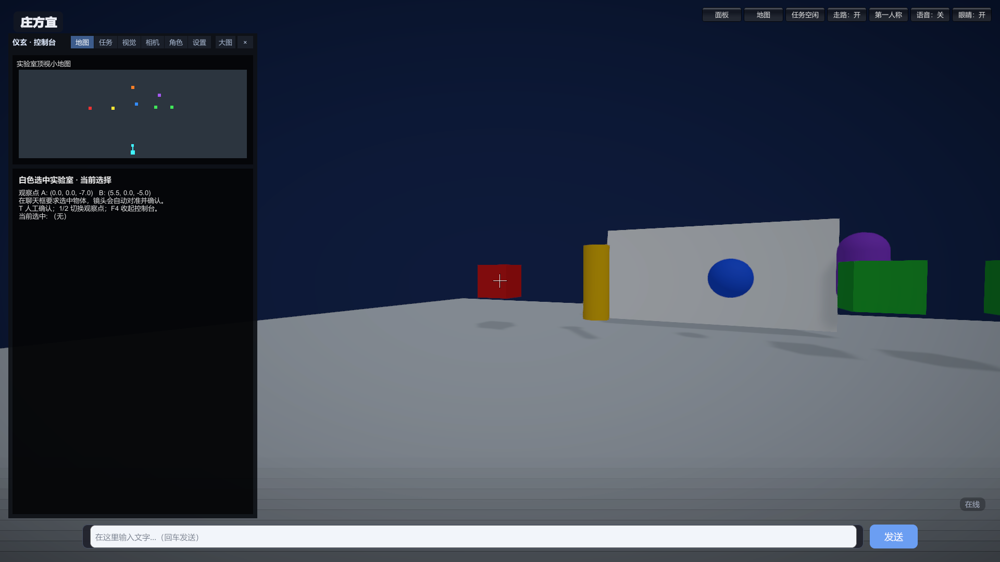
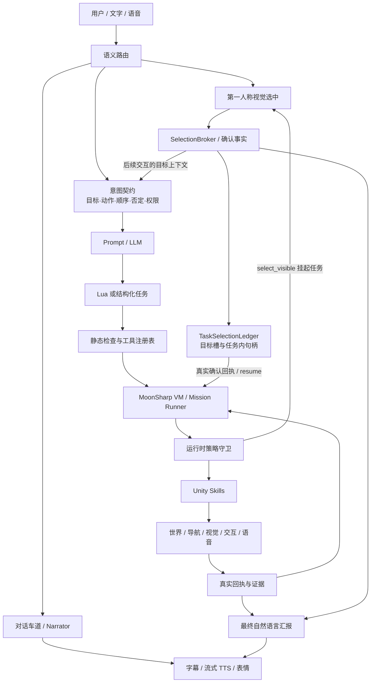

# AI 驱动的数字人 | Unity AI Character Interaction System

> **策划方向入口 → [项目策划案 / README Planning](README.planning.md)**：立项目标、体验设计、功能拆解与技术方案取舍。

  

  <strong>让数字人听懂指令、看见世界、执行任务，并用真实回执说明结果。</strong>

  <a href="https://github.com/wbcyyds123321/digital-human">源码</a> ·
  <a href="README.planning.md">策划案 / 功能设计</a> ·
  <a href="docs/architecture.md">架构总览</a> ·
  <a href="docs/progress-2026-11-12.md">最新进展</a> ·
  <a href="docs/roadmap.md">路线图</a> ·
  <a href="https://github.com/wbcyyds123321/-MapGen">地图生成器</a>

> 这是一个 Unity 数字人交互系统的源码展示快照，不是下载后即可运行的完整 Unity 工程。仓库不包含角色模型、地图二进制、动画、音频、第三方包或 API Key。

**从游戏策划角度了解项目：** [立项、体验目标与功能设计](README.planning.md)。文档按照“玩家需要什么 → 需要哪些功能 → 怎样实现 → 如何验证”梳理低延迟语音、地图与实体 ID、第一人称选物、交互衔接和 Lua 动作编排，并区分已实现、局部验证和后续规划。

## 最新进展 · 2026-11-12

**视觉选中已接入 Lua 的可等待工具调用**：任务可在确认目标 A 后继续移动或转向，再用新画面选择 B，并保留 A 的任务内引用。源码包含目标槽、确认句柄、任务内选中账本和基于真实回执的阶段汇报。

目前已有连续选择、移动后重新观察、复用先前目标和主动取消的真实局部样本；**组合语义仍有已知误路由，连续视觉动作尚未整体验收通过**。当前重点是统一语义决策，保留已验证的空间绑定与执行守卫。[验证结果与未完成项 →](docs/progress-2026-11-12.md)

## 这个项目解决什么问题

把“模型说它做到了”和“世界真的发生了”分开。模型负责理解、定位和规划，Unity 负责执行并返回可核验事实：

- **能听懂**：文字或语音先变成带目标、动作、顺序和约束的任务契约；
- **能看见**：视觉模型只判断当前画面中的二维位置，实体身份由 Unity 的同帧 ID/depth 绑定；
- **能执行**：Lua/MoonSharp 任务只能调用注册工具，导航、动作、交互和语音都受运行时守卫；
- **能解释**：最终回答引用真实回执、坐标、距离、朝向和失败原因，而不是臆造状态。

## 项目定位

数字人是运行在 Unity 3D 世界中的 AI 角色：

- 用户用文字或语音提出目标；
- 系统把自然语言整理成可验证的任务意图和执行约束；
- Unity 负责移动、转向、动作、视觉、交互和语音播放；
- 每一步都以真实组件回执为准，再生成最终汇报。

核心设计是把“模型生成”和“世界执行”分开。LLM 可以提出计划或 Lua 程序，但不能凭空声称角色已经走到、看见或选中了某个目标。

## 实机展示

### 第一人称视觉选中

视觉模型接收当前 EyeCamera 的原始 RGB 图像，输出二维点或框。Unity 用同帧 ID/depth 绑定实体，真实转动 Eye，再以新帧中心像素的实体 ID 与深度确认目标。选中后，统一 HUD 显示实体 ID、世界坐标、距离和朝向。

  

*白盒截图：手动对准与确认，用于展示高亮、坐标和新版 HUD。自动闭环验证范围见[最新进展](docs/progress-2026-11-12.md)。*

  

车辆图来自一次 DeepSeek 单图视觉选中实测：模型给出点/框，系统完成同帧绑定、真实转向、新帧中心确认和共享选中记录。

### 统一 HUD

地图、任务、视觉、相机、角色和设置收拢到同一个控制台；小地图、选中事实和任务状态使用同一套运行时数据。

  

## 核心架构

| 层次 | 技术与实现 |
|---|---|
| 引擎与表现 | Unity 2022.3 LTS、URP、C#、VRM / MMD 骨架适配、Mixamo 动作 |
| 语言与任务 | DeepSeek、独立意图契约、MoonSharp Lua、可等待视觉工具、任务内目标账本、真实回执 |
| 视觉与空间 | EyeCamera、二维点框、同帧实例 ID / depth、相机矩阵、新帧中心确认 |
| 语音 | Python sidecar、SenseVoice / sherpa-onnx、Silero VAD、MiniMax 流式 TTS、口型 |
| 世界 | Blender / Python 地图工具、碰撞 AABB、导航图 A*、语义锚点、地面高度图 |

### 1. 自然语言到可执行任务

自然语言不会直接变成一串未经检查的动作。任务入口先识别目标、动作、顺序、否定和权限，再生成独立任务契约。

~~~text
用户指令
  -> Task Router
  -> Intent Contract
  -> Lua / Mission Plan
  -> Program Lint
  -> MoonSharp VM
  -> Tool Registry + Policy Guard
  -> Unity Skill
  -> MissionStepResult
  -> Lua Resume / Final Report
~~~

工具注册表统一描述工具名称、参数、资源占用、超时、幂等性和副作用。运行时回执决定下一步，模型文本本身不能替代回执。

相关源码：

- [任务契约](unity/Assets/Scripts/AI/Tasks/TaskIntentContract.cs)
- [工具注册表](unity/Assets/Scripts/AI/Tasks/TaskToolRegistry.cs)
- [程序检查](unity/Assets/Scripts/AI/Tasks/TaskProgramLint.cs)
- [任务执行器](unity/Assets/Scripts/AI/Tasks/TaskMissionRunner.cs)
- [Lua 运行时](unity/Assets/Scripts/AI/Tasks/TaskLuaRuntime.cs)

### 2. 把视觉选择串进行动程序

“选中”现在是可等待的任务动作。`select_visible(description, {slot=...})` 先验证契约中的目标槽，只有完成真实视觉定位、对准和新帧确认后，才返回任务内 `target_ref` 并继续 Lua。

~~~text
契约声明目标槽 A / B
  -> select_visible(A) -> 确认后绑定 target_ref_A
  -> 移动 / 身体转向 / Eye 转向
  -> select_visible(B) -> 从当前新帧绑定 target_ref_B
  -> 后续工具仍可引用 target_ref_A
  -> 按真实工具回执汇报阶段结果
~~~

`TaskSelectionLedger` 区分“任务内部切换目标”和“用户外部换选/取消”：选择 B 可以保留 A；外部变更、失效实体和过期任务不能继续使用旧授权。目标不存在时不得借用旧的全局 Current 继续移动。身体朝向与 Eye 朝向分别处理，后续相机角度以当前 Eye 为基准累积。

上图说明已实现的编排机制；真实局部样本与尚未通过的组合语义见[验证表](docs/progress-2026-11-12.md)。

相关源码：[视觉任务工具](unity/Assets/Scripts/AI/Tasks/TaskMissionRunner.TaskVisual.cs) · [目标账本](unity/Assets/Scripts/AI/Tasks/TaskSelectionLedger.cs) · [阶段汇报](unity/Assets/Scripts/AI/Tasks/TaskPhaseSummary.cs) · [选择语义路由](unity/Assets/Scripts/AI/Tasks/SelectionIntentRouter.cs)

### 3. 第一人称视觉选中闭环

~~~text
EyeCamera 原始 RGB
  -> deepseek-flash 输出 point_uv / bbox_uv
  -> 同一帧 RGB + ID + depth 绑定
  -> 解析实体稳定 ID 与表面点
  -> 真实 Eye 转向目标
  -> 新帧中心确认
  -> PickService / SelectionBroker 发布
  -> 高亮、坐标、小地图、LLM 回答
~~~

模型看不到世界坐标、实体目录或全图候选答案。它只负责回答“画面中目标大概在哪里”；实体身份和坐标由 Unity 的同帧缓冲、稳定实例 ID 和冻结相机矩阵确定。

这条链路把模型判断与运行时身份确认分开：

1. 两个外观相同的物体具有不同实例 ID，运行时能记录实际选中了哪一个；自然语言是否指对目标仍要独立验证。
2. 模型点落在背景时，仅允许在其输出框内恢复唯一可靠候选；歧义或矛盾应拒绝，不从全图替换答案。

同帧 ID 能证明“射线/中心实际指向哪个实体”，不能单独证明“这个实体符合用户语义”。最近一轮保留了错认目标的原始失败；修复后的本地回放与真实模型重验分列。

相关源码：

- [拾取数据结构](unity/Assets/Scripts/Selection/SelectionTypes.cs)
- [实体注册表](unity/Assets/Scripts/Selection/EntityPickRegistry.cs)
- [视觉定位服务](unity/Assets/Scripts/Selection/FirstPersonTargetingService.cs)
- [中心像素拾取与确认](unity/Assets/Scripts/Selection/PickService.cs)
- [共享选中状态](unity/Assets/Scripts/Selection/SelectionBroker.cs)
- [Eye 云台](unity/Assets/Scripts/Vision/EyeGimbalController.cs)

默认视觉 provider 是 DeepSeek，模型是 deepseek-flash，使用官方 OpenAI 兼容端点；当前发布配置没有默认 fallback。服务额度、网络和 API 配置由使用者自行提供。

### 4. 语音与对话生命周期

语音 sidecar 负责本地音频输入、VAD/ASR、流式 TTS、打断和口型数据。Unity 侧按 turn、service、token 隔离播放生命周期：

~~~text
输入 utterance
  -> ASR final / UI text
  -> semantic turn
  -> LLM 流式回复
  -> 分句 TTS 队列
  -> audio_start
  -> 播放 / 口型
  -> finish 或 cancel
~~~

旧 turn 的迟到事件不能结束新 turn；UI 打断也要经过时间栅栏。受控注入链路已有验证，真人麦克风、口音、环境噪声、回声消除、长期稳定性和主观听感仍需继续实测。

相关目录：[语音 sidecar](voice/README.md)、[语音源码](voice/)、[Unity 语音脚本](unity/Assets/Scripts/Voice/)。

### 5. 世界、导航与角色

苏式蓝调地图由独立地图生成器制作，再导出 Unity 可消费的碰撞、导航、锚点和地面高度数据：

~~~text
Blender / Python 规划
  -> GLB / 场景清单
  -> 碰撞 AABB + 导航图 + 语义锚点 + ground height
  -> WorldData
  -> A* 路径与 CharacterLocomotion
  -> Unity 中的真实移动回执
~~~

角色没有 Rigidbody 或 CharacterController，移动由 CharacterLocomotion 驱动，接地由地面高度数据处理。该数字人使用 MMD 血统骨架；MmdDeformBridge 把控制骨同步到真正受蒙皮权重影响的变形骨，避免“骨骼在动但网格不动”。

相关项目与源码：

- [地图生成器](https://github.com/wbcyyds123321/-MapGen)
- [世界数据](unity/Assets/Scripts/World/WorldData.cs)
- [角色移动](unity/Assets/Scripts/Motion/CharacterLocomotion.cs)
- [MMD 变形骨桥接](unity/Assets/Scripts/Motion/MmdDeformBridge.cs)
- [统一 HUD](unity/Assets/Scripts/UI/UnifiedHud.cs)

### 6. 选中是交互的预备，不是终点

选中的目的不是“把它框出来”，而是拿到这个对象的身份，再决定对它做什么。一次确认过的选中会产出稳定实体 ID、世界坐标和朝向；之后所有针对它的动作都以这个 ID 为目标，而不是让模型对着画面再猜一次。

目前已经跑通两件具体的事：

~~~text
选中长椅 -> game.sit(长椅实体 ID)     走到位、对齐、坐下、起身，状态以座椅控制器回执为准
选中车辆 -> game.board_vehicle(ID)    走到车侧上车，再 game.drive_vehicle(目的地) 开走并停车
~~~

两件事走的是同一套结构：**选中给身份，实体给能力，契约给授权**。坐和起必须来自一次已确认的选中——没有确认过的目标，`sit` / `stand` 直接拒绝；上车同理，没有 `vehicle_id` 就没有 `board_vehicle`。

这也是留给更多物件的接口。每多一种交互（更多家具、载具、场景装置），它只需要在能力表里声明“我能被做什么”，选中负责指认“是哪一件”，契约负责说明“这次允许做什么”。三者分开，才不会退化成“点一下什么都能干”。

## 白盒选择实验室

发布快照包含一个独立白盒场景，用于把视觉选中从复杂大地图中隔离出来：

- 7 个显式几何体实例；
- 两个外观相同但 ID 不同的绿色方块；
- 屏风后的不可见橙球作为 not_found 负例；
- 两个观察点；
- RGB、ID、depth、Eye、中心确认、Broker、高亮、坐标和小地图共用主链路。

在完整 Unity 工程中，可通过菜单构建：

~~~text
Tools / 白色选中实验室 / 构建实验室场景
~~~

实验室用于验证“当前画面中找物体并确认”，不等同于通用视觉识别准确率，也不替代复杂苏联地图、驾驶、座椅和上下车的全量回归。

## 当前状态与边界

| 能力 | 当前口径 |
|---|---|
| 自然语言任务契约、Lua 执行、Unity 真实回执 | 已有可复现链路 |
| 单次第一人称物体视觉选中 | 已有 DeepSeek 实测样本 |
| 稳定实例 ID、同帧 ID/depth、中心确认、共享 Broker | 已接入并在白盒实验室验证 |
| 统一 HUD、地图页、选中坐标和小地图 | 已接入白盒与主地图代码 |
| 语音注入链路、受控打断、最终正文 TTS | 已有受控验证 |
| 真人麦克风、噪声、回声、长期运行和听感 | 待继续实测 |
| 可等待视觉工具、目标槽、确认句柄与任务内目标账本 | 已实现，已做本地/运行时关键检查 |
| 连续选 A/B、移动后新帧选择、保留 A 引用 | 有真实局部通过样本；整体尚未验收通过 |
| “选中后描述/解释”的组合语义 | 仍有误判为聊天的反例，待统一语义决策 |
| 取消中的真实迟到 HTTP 回包 | 主动取消有样本，真实迟到回包仍待验证 |
| 目标中心绕圈 | 未启动 |
| Jev 辅助判断与统一语义层 | 方案与评测阶段，尚未接入 |
| 复杂大地图中的全场景视觉泛化 | 未宣称完成 |
| 完整驾驶、座椅、上下车和电车全量回归 | 不在本发布快照结论内 |

## 目录

~~~text
unity/
  Assets/Scripts/AI/          对话、意图、任务、Lua 与工具路由
  Assets/Scripts/Selection/   第一人称拾取、ID/depth、中心确认、Broker
  Assets/Scripts/Vision/      EyeCamera、视觉请求与观察
  Assets/Scripts/Voice/       Unity 语音队列、打断与口型
  Assets/Scripts/Motion/      移动、接地、动作和骨骼桥接
  Assets/Scripts/World/       地图数据、碰撞和导航
  Assets/Scripts/UI/          统一 HUD 与小地图
  Assets/Editor/              场景构建和小范围验收工具
voice/                        Python 语音 sidecar
map/                          地图生成与 Unity 数据导出快照
docs/                         架构、路线图和展示图片
~~~

## 运行与开发

本仓库不包含完整 Unity 工程配置。要运行完整体验，需要自行准备：

1. Unity 2022.3.62f3c1 与 URP 工程；
2. 角色、地图、动画、音频和第三方依赖；
3. DeepSeek API 配置，以及需要的语音服务；
4. 将本仓库的 unity/、voice/、map/ 内容合入对应工程；
5. 在 Unity 中按项目文档构建场景，再进入 Play。

任何 API Key、录音、缓存和本机模型都不应提交到仓库。

## 文档

- [策划案：立项、体验目标与功能设计](README.planning.md)
- [架构总览](docs/architecture.md)
- [2026-11-12 最新进展与验证边界](docs/progress-2026-11-12.md)
- [统一语义决策方案（待实现）](docs/semantic-decision-plan.md)
- [2026-11-11 历史进展](docs/progress-2026-11-11.md)
- [路线图](docs/roadmap.md)
- [语音 sidecar](voice/README.md)
- [地图工具](map/README.md)
- [地图集成规范](map/integration/INTEGRATION_SPEC.md)

## License

源码采用 [MIT License](LICENSE)。

角色模型、贴图、动画、音频、地图资产、第三方包和外部模型服务不包含在本仓库内，也不随 MIT License 授权。
