# Become Human · 从自然语言到三维场景行动

**Unity AI 角色交互原型：让角色理解请求、观察眼前的场景、执行获准的行为，并给出有依据的反馈。**

[策划案与设计取舍](README.planning.md) · [技术架构](docs/architecture.md) · [截图与证据索引](docs/showcase-evidence.md) · [当前验证边界](docs/progress-2026-11-16.md) · [配套 MapGen](https://github.com/wbcyyds123321/-MapGen)

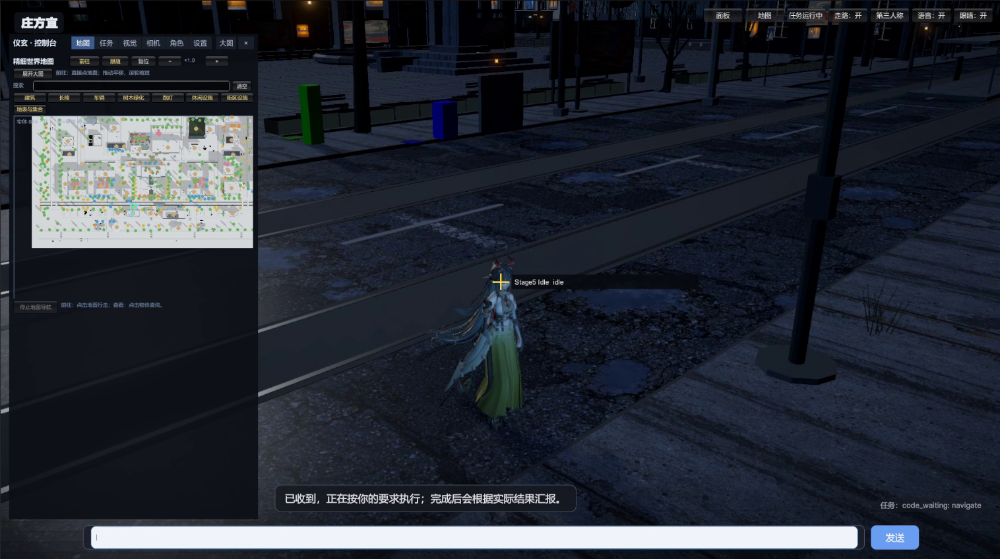

*三维社区是角色行动的载体。本文的运行截图来自本地完整工程；公开仓库是脱敏后的源码展示快照，不含模型、完整地图资产、第三方包或服务凭据。*

## 先看项目做到了什么

玩家说“走到广场去”，角色需要真实移动；说“选中左边的红色立方体”，系统需要确认具体实体；说“没有找到就不要继续”，后续动作需要受到限制。项目围绕这类小任务，连接语言、视觉、导航、动画和语音。

| 可以看到的结果 | 背后需要解决的问题 | 当前证据 |
|---|---|---|
| 白盒中按文字请求选中物体，并显示 ID、距离和坐标 | 图片中的二维位置怎样落到三维实体；转动后怎样确认仍是它 | 单次真实视觉选中样本、同帧缓冲与运行回执 |
| 苏联风格社区内走近长椅、坐下、起身 | 接近位置、身体对齐、座位状态与动画怎样衔接 | 独立实录样本；不推导为所有家具均可交互 |
| 走近公交、上车、短程驾驶、停车、下车 | 多步骤等待、载具能力、导航与完成回执怎样一致 | 独立任务样本，驾驶约 34.6 m；取景仍有遮挡 |
| 对话文字转为真实语音，角色随音频开合口型 | 流式生成、播放与取消怎样管理，旧轮次怎样隔离 | 实际 TTS 播放；尚非逐音素口型或真人 ASR 验收 |

### 实机图集

<table>
<tr>
<td width="50%">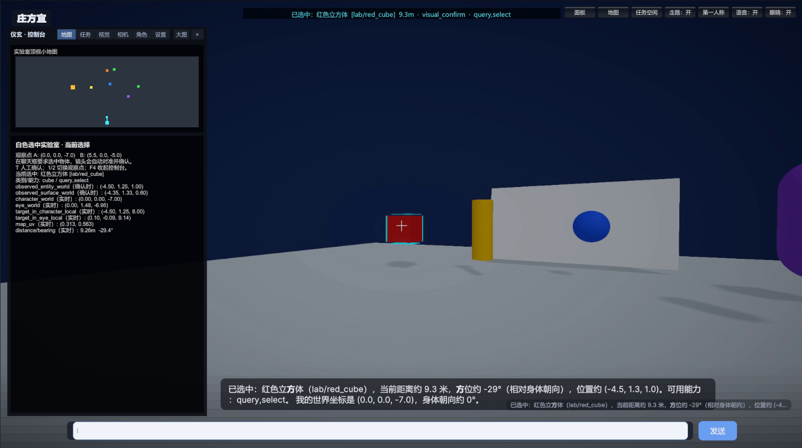<br><b>确认具体对象</b>：高亮与 ID/坐标来自引擎。</td>
<td width="50%">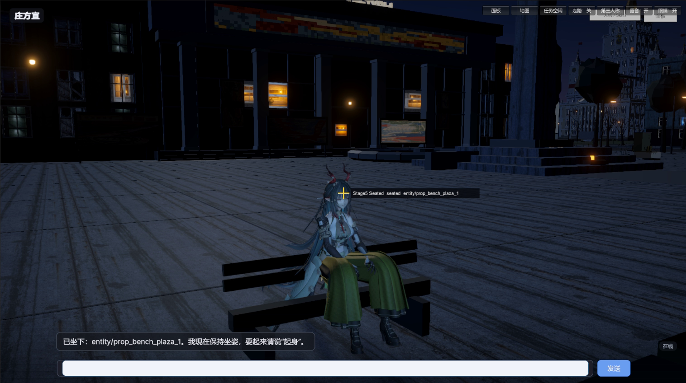<br><b>场景交互</b>：走近、对齐、落座。</td>
</tr>
<tr>
<td>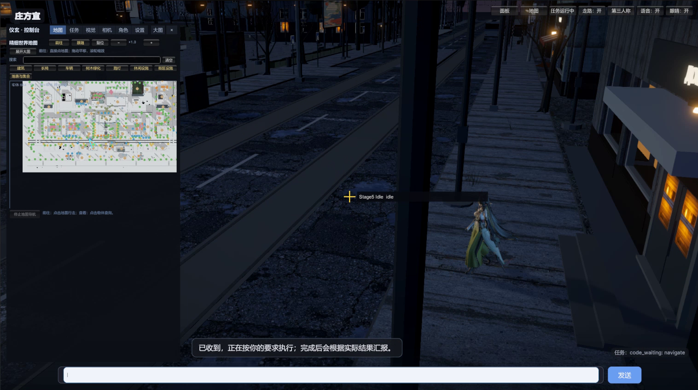<br><b>空间反馈</b>：地点、朝向和导航入口。</td>
<td>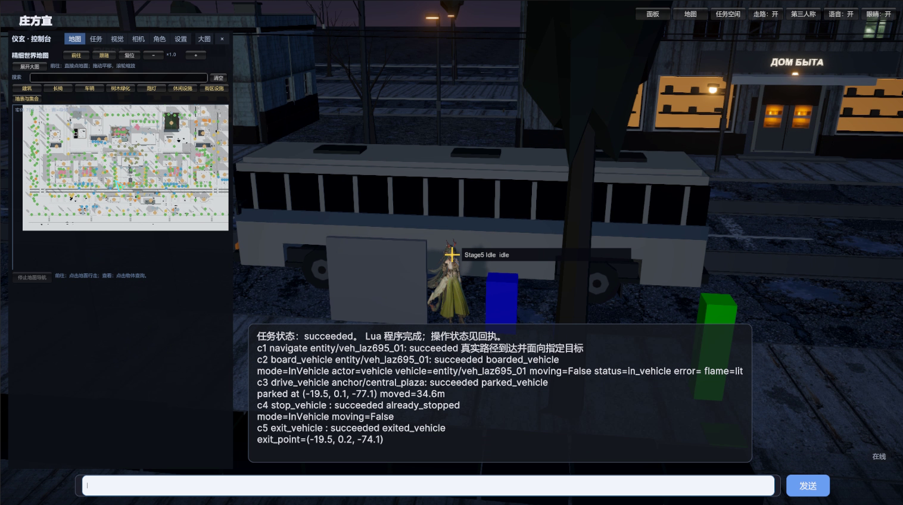<br><b>多步骤任务</b>：上车、驾驶、停车、下车。</td>
</tr>
</table>

截图能说明画面中的状态，不能单独证明整条任务成功。每张图的来源、测试性质与可支持的结论见[证据索引](docs/showcase-evidence.md)。白盒、座椅和驾驶是独立样本，不拼成一次连续成功。

## 设计主线：语言负责提出，运行时负责兑现

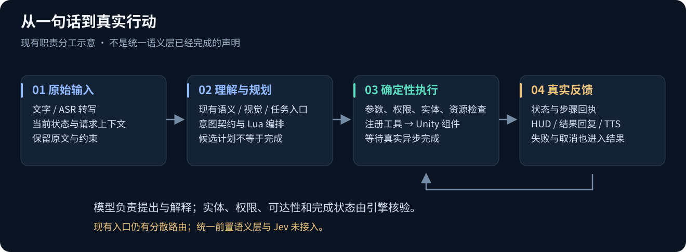

**原始请求、模型判断和世界事实分别保存。** 模型生成“走到了”不算完成；导航到达、视觉确认、座椅状态或车辆回执才是完成依据。

现有入口仍包含对话、视觉与任务等多条路由。图中的统一事实来源不意味着已经完成统一前置语义层：复合句仍有误路由反例，详见[已知限制](#当前状态与已知限制)。

| 模块 | 职责 | 不交给它的事情 |
|---|---|---|
| LLM / 视觉模型 | 理解开放表达、提出任务程序、定位图像目标、根据事实组织回复 | 决定实体是否存在、任务是否真正完成、能否绕过权限 |
| 意图契约与工具接口 | 记录目标、顺序、限制与允许动作；定义参数和回执 | 因为生成程序用了某个工具，就倒推用户授权过它 |
| Unity 执行层 | 校验实体与资源、移动/转向/交互、处理取消、记录结果 | 用一句成功文本替代组件状态 |
| HUD 与语音 | 呈现选中事实、任务阶段和实际结果 | 把开始执行说成已经完成 |

## 难点一：模型说“看到了”，怎样确认是哪一个

视觉定位和场景拾取分两步。视觉模型接收原始 RGB 与目标描述，输出二维点或框；它不直接提供世界坐标。Unity 在**对应帧**的实例 ID/depth 中绑定实体及表面点，随后真正转动 Eye，再从**新帧中心**核对目标。

视觉观察来自角色的 EyeCamera；展示用的第三人称相机独立。Eye 云台转动也不等同于可见头骨转动。

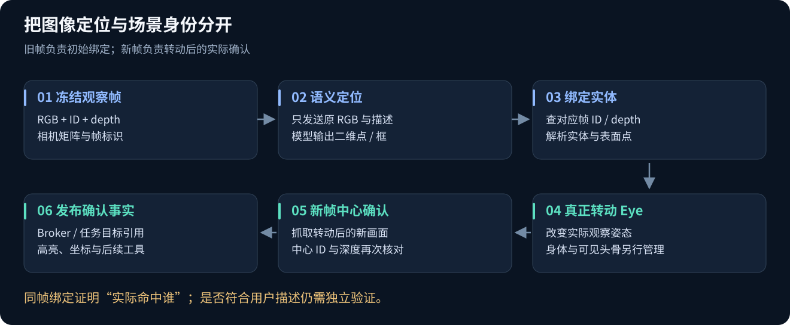

<table>
<tr>
<td width="50%">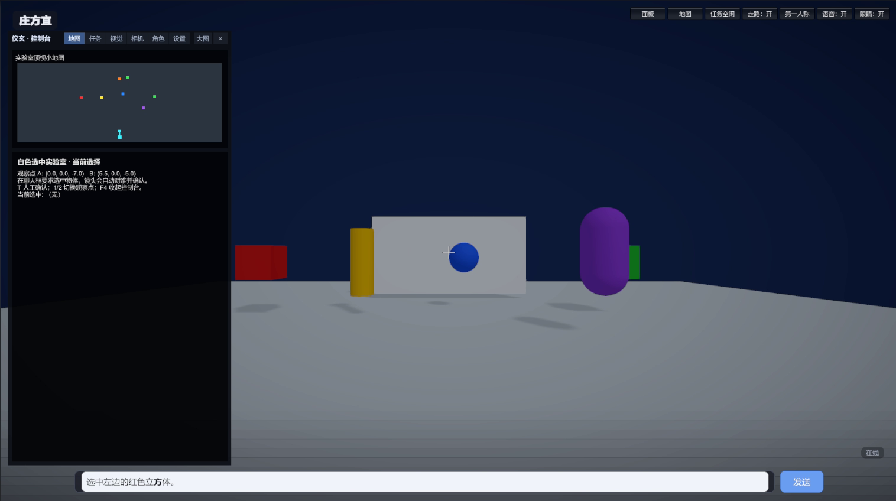<br><b>请求</b>：文字经输入框提交；拍摄驱动方式另行披露。</td>
<td width="50%"><br><b>确认</b>：完成后才发布实体事实。</td>
</tr>
</table>

这条链路处理了三个容易混淆的问题：

1. **外观与身份不同。** 两件物体即使长得一样，也有各自的实体 ID。ID 能说明实际命中了谁，仍需另验是否符合用户描述。
2. **图像坐标有时效。** 转头或移动后不能把旧图里的点直接套在新视角上；确认必须来自转动后的新帧。
3. **找不到不能借旧目标。** 本次定位失败时，后续工具不能把上次选中的对象当成本次结果。

<table>
<tr>
<td width="50%">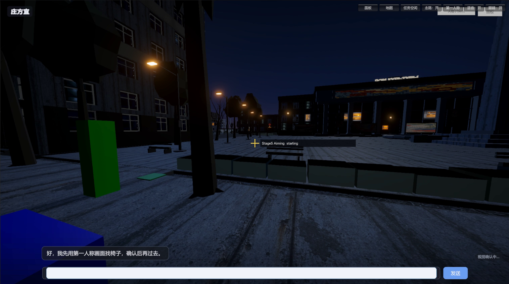<br><b>过程态</b>：对准之后仍需等待确认。</td>
<td width="50%">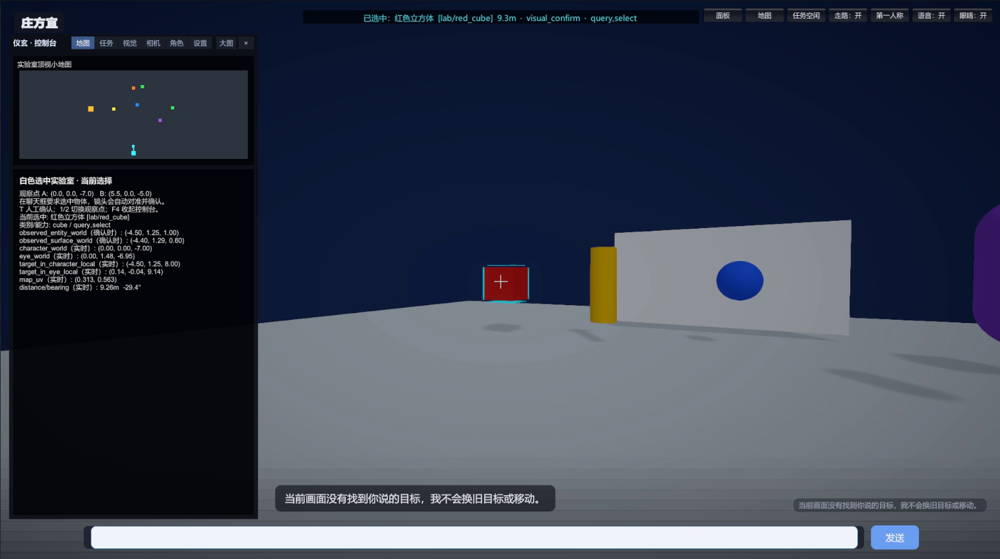<br><b>失败态</b>：本次未找到；旧选择横幅仍残留，反馈需要进一步区分。</td>
</tr>
</table>

负例图保留了一个实际 UI 问题：底部已经拒绝本次请求，顶部却仍显示旧选择。拒绝回执与当前选择需要更清楚地分层，避免玩家误以为本次已成功。

### 同帧数据怎样配合

<table>
<tr>
<td width="33%">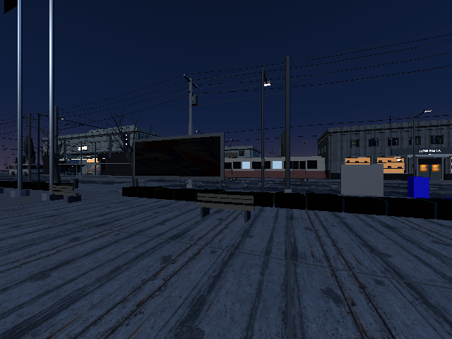<br>RGB：模型可见的画面</td>
<td width="33%">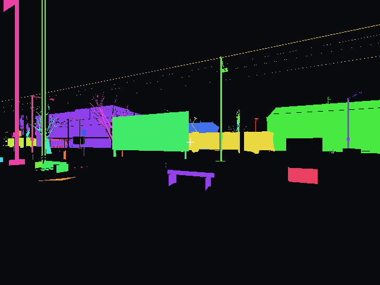<br>ID：引擎区分实例</td>
<td width="33%">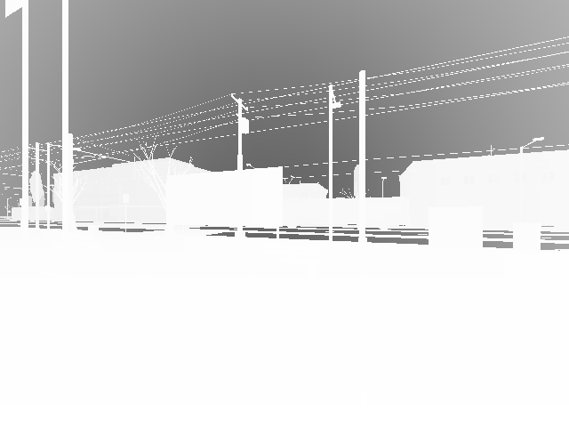<br>Depth：恢复表面位置</td>
</tr>
</table>

*三张图来自同一份历史帧记录；ID/depth 是供人阅读的可视化，不是额外发送给模型的答案。这组图解释数据关系，不作为新增真实模型验收。*

如果模型点落在背景，只允许在模型给定区域内进行受限恢复；多个候选矛盾时应拒绝。不能全图寻找一个“可能对”的对象补成成功。现有保护有真实失败和修复回放，尚未完成所有真实重验。

源码：[视觉服务](unity/Assets/Scripts/Selection/FirstPersonTargetingService.cs) · [拾取与确认](unity/Assets/Scripts/Selection/PickService.cs) · [实体映射](unity/Assets/Scripts/Selection/EntityPickRegistry.cs) · [共享选中事实](unity/Assets/Scripts/Selection/SelectionBroker.cs)

## 难点二：一句话安排多个动作，怎样等待并保留目标

视觉服务、导航和语音都有各自的异步完成时刻。“请求已发出”不能当成“执行完成”。任务通过 MoonSharp Lua 协程调用注册工具，挂起等待回执，再决定继续、失败或取消。

下面是**编排意图示意**，不是可直接执行的 API，也不表示整条真实模型链已验收：

```text
契约声明目标槽 A、B 与允许动作
  选中 A → 等待确认 → 保存引用 A
  接近 A → 等待到达
  转向 → 等待实际完成 → 使用新画面
  选中 B → 等待确认 → 保存引用 B
  再使用 A → 核对任务、实体与授权仍有效
  按实际完成步骤汇报
```

`SelectionBroker.Current` 服务于当前界面选择；`TaskSelectionLedger` 保存任务内的多个目标引用。内部选择 B 可以保留 A，用户外部换选、取消或实体失效则走不同的生命周期规则。

契约、程序检查和运行时守卫分工：

| 检查时刻 | 关键问题 |
|---|---|
| 提取任务契约 | 用户要执行什么、禁止什么；描述来自原文哪里 |
| 生成 Lua 后 | 是否只调用允许工具；步骤与契约是否一致 |
| 工具开始前 | 目标句柄有效吗；路径/能力/资源满足吗 |
| 异步结果到达 | 还是这项任务、这次请求吗；有没有被取消或替换 |
| 最终汇报 | 哪些步骤真的完成；哪些失败、取消或没有执行 |

源码：[意图契约](unity/Assets/Scripts/AI/Tasks/TaskIntentContract.cs) · [工具注册表](unity/Assets/Scripts/AI/Tasks/TaskToolRegistry.cs) · [程序检查](unity/Assets/Scripts/AI/Tasks/TaskProgramLint.cs) · [Lua 运行时](unity/Assets/Scripts/AI/Tasks/TaskLuaRuntime.cs) · [视觉任务桥接](unity/Assets/Scripts/AI/Tasks/TaskMissionRunner.TaskVisual.cs) · [目标账本](unity/Assets/Scripts/AI/Tasks/TaskSelectionLedger.cs)

## 难点三：选中之后，怎样成为有前提的交互

高亮是确认反馈，后续行为还需要实体能力、合法接近点和明确授权。可以被看见的对象，不一定可以坐、驾驶或拾取。

<table>
<tr>
<td width="50%"><br><b>座椅</b>：接近与对齐后进入坐姿。</td>
<td width="50%">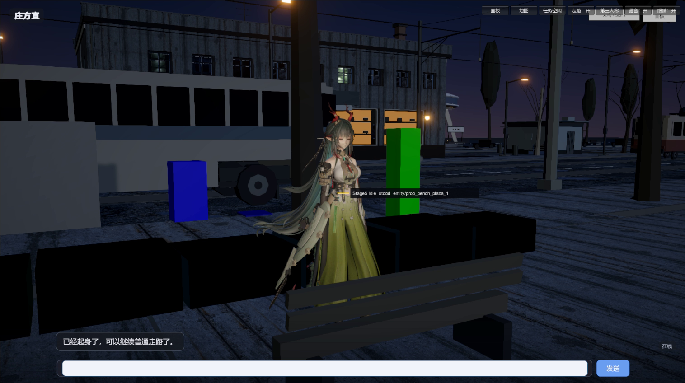<br><b>恢复</b>：起身后回到可行走状态。</td>
</tr>
</table>

座椅链路需要处理“走到附近”和“可以落座”的区别；车辆链路则需要等待接近、上车、驾驶、停车、下车各阶段回执。任务工具消费实体能力和交互状态，不因为一个对象获得高亮，就赋予它所有能力。

11 月 16 日的独立实录保留了长椅交互及公交短程任务样本；公交任务记录了约 34.6 m 行驶及五步成功回执。**该驾驶样本来自具名任务，不是“视觉选中车辆→驾驶”整链的新增证明。** 相机仍有车身遮挡，截图只选可读状态，不以遮挡画面宣称良好驾驶体验。


源码：[任务工具执行](unity/Assets/Scripts/AI/Tasks/TaskMissionRunner.cs) · [座椅控制器](unity/Assets/Scripts/Stage4/Stage4SeatController.cs) · [动态实体系统](unity/Assets/Scripts/Dynamic/DynamicActorSystem.cs) · [动态实体数据](unity/Assets/Scripts/Dynamic/DynamicEntities.cs)

## 难点四：聊天、行动与取消，不能互相误伤

“边走边聊”“先停一下，挥手后继续”“取消这次任务”涉及不同语义。当前对话与行动有独立请求和生命周期；聊天发起的导航也能被承接为可暂停任务，保留剩余路径，再接入既有插入/恢复机制。


曾出现的实际问题包括：新聊天把行走停掉、思考动作覆盖走路动画，以及旧语音结束事件影响新一轮。这些问题分别需要动作资源保护、父任务承接和轮次隔离，不能用单个“忙碌”开关概括。

取消不只停止当前电机，还要失效对应任务的后续恢复、工具结果和播报资格。已有受控运行时验证及真实主动取消样本；**取消后的真实 HTTP 迟到回包仍是待验项**，不能用取消了请求就推断迟到结果隔离已全面通过。

源码：[导航承接](unity/Assets/Scripts/AI/Tasks/TaskMissionRunner.NavAdoption.cs) · [暂停与插入](unity/Assets/Scripts/AI/Tasks/TaskMissionRunner.Interruption.cs) · [对话车道](unity/Assets/Scripts/AI/ChatSession.TaskDialogue.cs) · [语音队列](unity/Assets/Scripts/AI/Tasks/TaskSpeechQueue.cs)

## 难点五：地图好看，还要能被角色使用

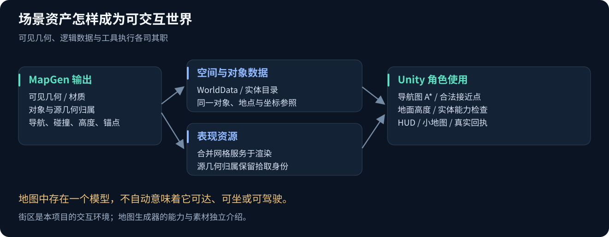

SovietBlueHour 由配套 MapGen 生成。地图进入 Unity 时，除可见模型外，还需要碰撞 AABB、导航图、语义锚点、实体归属和地面高度数据。

| 数据 | 用途 | 省掉后的问题 |
|---|---|---|
| 实体 ID 与源几何归属 | 合并网格后仍能识别具体对象 | 把一整批 Renderer 当成一件物体 |
| 碰撞 AABB 与导航图 | 规划角色可行走路径 | 地点坐标存在，却走不过去 |
| 语义锚点 | 将广场、入口等语言接到地图位置 | 模型猜坐标或地点缺少统一参照 |
| 地面高度 | 角色按实际铺装接地 | 穿地、悬空或草地/道路高度不一致 |
| HUD 与小地图 | 显示角色、朝向、地点和选中事实 | 玩家难以理解角色正在做什么 |

角色移动由 `CharacterLocomotion` 驱动；当前方案不依赖给角色添加 Rigidbody 或 CharacterController。地图数据为角色工具提供确定性基础，地图生成本身见 [MapGen](https://github.com/wbcyyds123321/-MapGen)。

源码：[世界数据](unity/Assets/Scripts/World/WorldData.cs) · [地图加载与高度](unity/Assets/Scripts/World/MapWorldProfile.cs) · [接地](unity/Assets/Scripts/Motion/GroundSnap.cs) · [实体目录](unity/Assets/Scripts/World/WorldEntityCatalog.cs) · [移动](unity/Assets/Scripts/Motion/CharacterLocomotion.cs) · [统一 HUD](unity/Assets/Scripts/UI/UnifiedHud.cs) · [地图集成规范](map/integration/INTEGRATION_SPEC.md)

## 难点六：接通动画和 TTS，距离自然表现还有多远

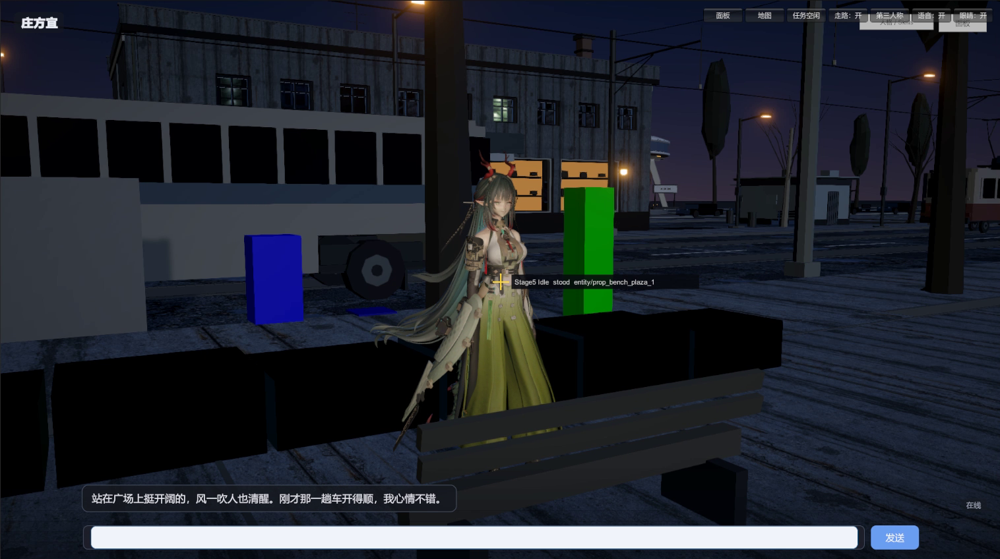

语音链路采用本地 Silero VAD、SenseVoice / sherpa-onnx 转写，结合流式文本和分句 TTS 队列。重点是把“等一句完整回复”拆成可以逐步处理和观测的阶段。

```text
麦克风 → VAD 分段 → ASR 最终文本 → 语义入口
文字输入 ──────────────────────┘
  ├→ 行动任务 → 真实阶段回执 → 结果播报
  └→ 流式回复 → 增量解析 / 分句 → TTS 音频块 → 播放 / 口型
```

| 处理环节 | 采用的规则 | 要避免的问题 |
|---|---|---|
| 输入 | 本地语音段检测与转写；保留 utterance / turn 关联 | 把一段语音拆错，或将旧转写归入新轮次 |
| 文本与音频 | 可用分句进入队列，音频块就绪后播放 | 全文生成和整段合成完全串行等待 |
| 播放事件 | 按轮次、服务和播放 token 核对 start / finish / cancel | 旧语音结束事件关闭新一轮口型或播放状态 |
| 打断 | 区分停止说话、暂停行动与取消任务 | 用户只想停止播报，却连带丢掉行走任务 |

空闲对话与任务旁白使用的播放路径存在差别；接通流式接口并不代表所有车道拥有相同的首声延迟。需要分别测量说话结束、转写完成、首段文本、首个音频块和实际停止时刻。真人口音、噪声和回声条件的体验仍待补测。

一个具体修复是长语音中途停止：历史运行中，25.632 秒音频只播放约 8.16 秒。原因是“必须在 10 秒内开始”的期限被持续当作播放有效期。修复将**开始期限**与**播放期间的持续有效条件**分开，保留真正的打断。定向验证使用已有真实音频与 Unity 播放，不是新增真人 ASR 或模型语义测试。

动画接入也有类似陷阱：历史仪玄模型的腿部控制骨权重为零，骨骼变化不代表蒙皮变化。项目定位后，按模型采用 D 骨直接映射或 `MmdDeformBridge` 的绑定姿态增量桥接；当前庄方宜的 Humanoid 映射直接使用 D 骨，桥接保留给旧模型回退。验证需要检查实际蒙皮输出，而非只看骨骼欧拉角。

当前口型是音频驱动的基础开合；Eye 相机、身体朝向和可见头骨旋转分别管理。角色自然度、动作过渡、镜头与长时对话体验仍需打磨，不将“已经接通组件”写成“表现已自然”。

源码：[语音说明](voice/README.md) · [语音服务](voice/voice_server.py) · [流式文本](unity/Assets/Scripts/AI/DeepSeekStream.cs) · [语音队列](unity/Assets/Scripts/AI/Tasks/TaskSpeechQueue.cs) · [变形骨桥接](unity/Assets/Scripts/Motion/MmdDeformBridge.cs) · [D 骨导入映射](unity/Assets/Scripts/ModelSwap/PmxImporter.cs) · [动作清单](unity/Assets/Scripts/Motion/MixamoActionManifest.cs)

## 当前状态与已知限制

**截至 2026-11-16：单角色交互原型，有真实局部样本；不是完整游戏，也未完成任意组合指令的整体验收。**

| 能力 | 当前结论 |
|---|---|
| 单次第一人称视觉选中 | 有真实模型成功样本；同帧绑定、转向与新帧确认已接入 |
| 白盒输入→确认、遮挡/目标缺失反馈 | 有独立实录；不作为通用识别准确率 |
| 座椅坐下、起身；具名公交短程任务 | 有 11 月 16 日独立实录；不是所有对象/路线全量回归 |
| 可等待视觉工具、目标槽、任务内引用 | 本地/运行时机制已有验证 |
| 连续选 A/B、转向后重选、复用 A | 有真实局部成功；连续多目标编排的整体验收仍未通过 |
| “选中蓝色球体，然后描述/解释结果” | 已知误路由：后半句可能覆盖前半句执行意图 |
| 正在执行时取消 | 有真实成功样本；真实 HTTP 迟到回包待验 |
| TTS 播放、语音生命周期 | 有真实播放及受控隔离验证；真人 ASR、噪声/回声/长期运行待验 |
| 同外观不同 ID 的新增自然语言演示 | 本次未取得成功镜头，不以 ID 缓冲代替语义正确率 |
| 统一前置语义层、Jev | 设计与评测方向，未集成 |
| 绕目标中心行走 | 未开始 |
| 多角色人设、长期记忆、关系、日程、热更新 | 后续规划 |

详细记录：[本次素材与验证边界](docs/progress-2026-11-16.md) · [上一轮真实失败与局部成果](docs/progress-2026-11-12.md) · [前置语义层方案](docs/semantic-decision-plan.md)

## 如何阅读源码

| 你关心的问题 | 入口 |
|---|---|
| 需求怎样变成有边界的行为 | [策划案](README.planning.md)、[架构](docs/architecture.md) |
| 一句话怎样生成并执行 Lua | [TaskMissionRunner](unity/Assets/Scripts/AI/Tasks/TaskMissionRunner.cs)、[TaskLuaRuntime](unity/Assets/Scripts/AI/Tasks/TaskLuaRuntime.cs) |
| 视觉怎样绑定实体并确认 | [FirstPersonTargetingService](unity/Assets/Scripts/Selection/FirstPersonTargetingService.cs)、[PickService](unity/Assets/Scripts/Selection/PickService.cs) |
| 目标为什么不会都挤在 Current 里 | [TaskSelectionLedger](unity/Assets/Scripts/AI/Tasks/TaskSelectionLedger.cs) |
| 暂停以后怎样继续原任务 | [NavAdoption](unity/Assets/Scripts/AI/Tasks/TaskMissionRunner.NavAdoption.cs)、[Interruption](unity/Assets/Scripts/AI/Tasks/TaskMissionRunner.Interruption.cs) |
| 语音为什么会串轮或被截断 | [TaskSpeechQueue](unity/Assets/Scripts/AI/Tasks/TaskSpeechQueue.cs)、[voice](voice/README.md) |
| 程序化地图怎样提供可交互数据 | [map](map/README.md)、[MapGen](https://github.com/wbcyyds123321/-MapGen) |

## 个人工作与素材说明

这是个人主导的项目。我的工作集中在交互目标与规则设计、需求拆解、技术方案取舍、模块与工具流程整合，以及运行验证和问题复盘。代码及部分程序化美术使用 AI Agent 辅助完成；不把 Agent 生成的全部代码表述为独立手写。

配套 MapGen 用于生成地图及交互数据。角色模型、动画、音色等包含第三方资源；展示这些资源不代表拥有其原创权。原始录屏、模型、音频、服务凭据和私人对话不随本仓库发布。

## 运行条件与许可

源码使用 Unity 2022.3 LTS / URP、C#、MoonSharp Lua 与 Python 语音 sidecar。公开仓库不含完整 Unity 工程配置、角色/地图二进制与第三方依赖，需要在自己的工程中补齐并配置服务，不能直接下载后启动完整演示。

```text
unity/   Unity 运行时脚本与 Editor 工具
voice/   Python 语音 sidecar
map/     地图工具与 Unity 数据导出
docs/    架构、案例图、证据说明、进展与路线图
```

源码采用 [MIT License](LICENSE)。第三方角色、贴图、动作、音频与外部服务不随 MIT License 授权。

[策划案](README.planning.md) · [截图与证据索引](docs/showcase-evidence.md) · [技术架构](docs/architecture.md) · [路线图](docs/roadmap.md)
