# 从一句话到场景行为：AI 数字人交互策划案

**设计目标：玩家用自己的话表达意图，角色在三维场景中采取行动，玩家能理解它做了什么、为何失败、何时可以继续。**

[项目与技术入口](README.md) · [功能拆解](#3-把体验要求拆成功能规则) · [问题与方案](#4-案例一看见了不等于选中了) · [验收与边界](#11-如何验收准确性控制感与体验) · [截图来源](docs/showcase-evidence.md)

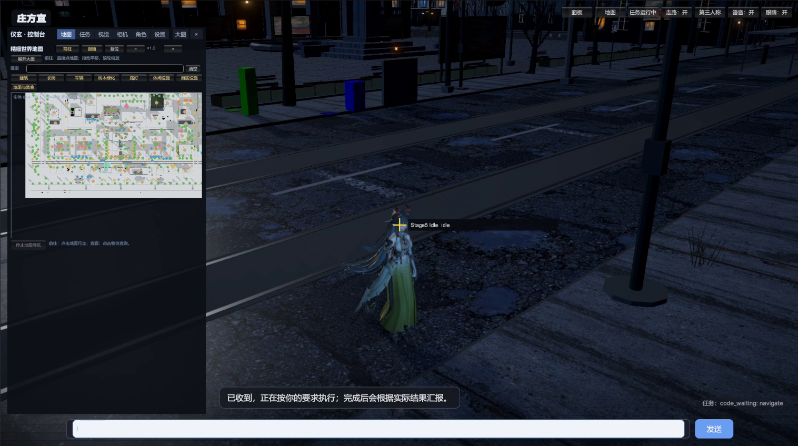

*个人主导的 Unity 交互原型，更新于 2026-11-16。本文区分当前实录、受控验证与设计目标；尚未形成包含奖励、成长和长期目标的完整游戏。*

## 1. 立项：为什么做一个能在场景中行动的角色

项目从数字人的语言、动作与表情反馈起步，逐渐遇到一个更具体的问题：玩家说“那个”“过去一点”“转过来再看”，这些表达怎样落到场景中的对象、位置和行为上？

单靠自然语言回复，角色可以听起来理解了，世界却没有变化；只有固定按钮，玩家又需要先学会系统的命令表。我的目标是在自然表达与明确规则之间建立连接，让玩家可以提出意图，同时保有对行为的预期和控制权。

| 项目项 | 当前设计 |
|---|---|
| 交互主体 | 玩家与单个三维 AI 角色 |
| 主要载体 | SovietBlueHour 社区地图；用于隔离问题的白盒实验室 |
| 玩家输入 | 文字、语音入口、明确的 HUD 操作 |
| 角色反馈 | 语言/语音、物体高亮、视角、移动、动作与执行状态 |
| 本阶段成果 | 能解释与验证的若干小任务及其执行底座 |
| 优先级 | 先完善单角色交互，再考虑多角色、人设、记忆与社区日程 |

### 我希望这个项目体现的技术策划工作

- **把模糊想法变成可试的交互。** 从“角色看懂环境”拆出输入、目标、操作、反馈与失败条件。
- **把体验约束落实到实现。** “只看不走”“先做 A 再做 B”“取消后别再继续”要进入契约与运行时规则。
- **搭建可迭代的工具。** 统一 HUD、白盒场景、地图数据和回执，帮助定位问题发生在哪一层。
- **根据反例修正方案。** 记录错选、误执行、动画冲突和语音截断，避免用一次成功替代能力判断。

代码和部分程序化美术由 AI Agent 辅助；个人工作是设计、方案取舍、整合、测试与复核。第三方角色与动作资源按来源使用。

## 2. 玩家能经历什么

下面是**独立的已录制小任务**，不是一条连续剧情。它们用于回答各自的交互问题。

<table>
<tr>
<td width="50%">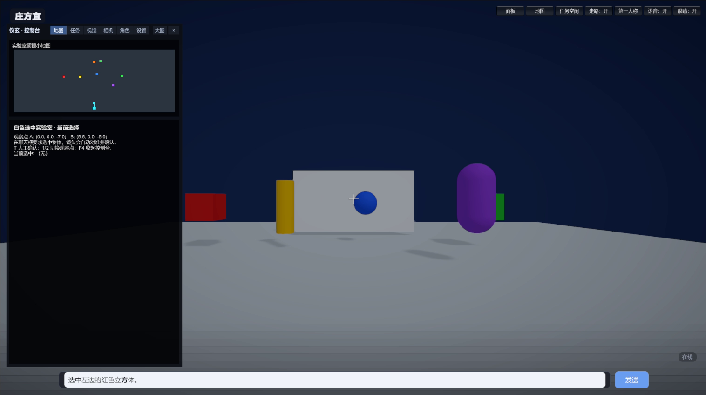<br><b>表达</b>：选中左边的红色立方体。</td>
<td width="50%">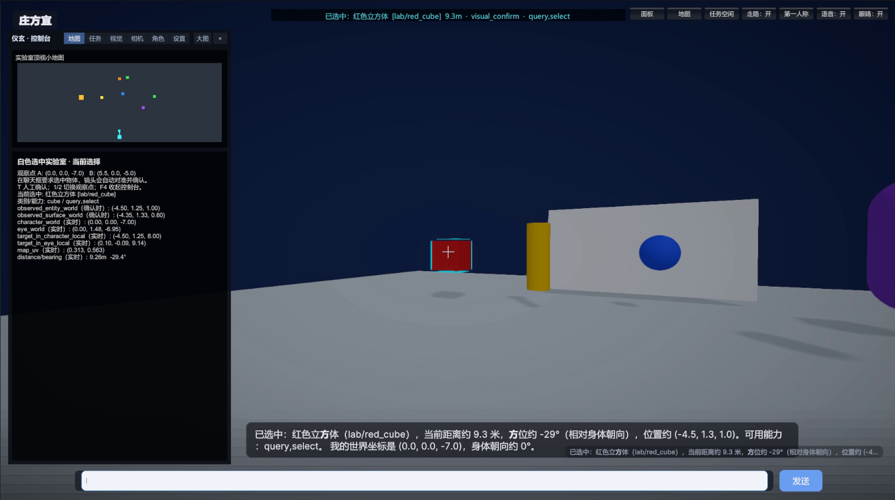<br><b>确认</b>：让玩家看见实际选的是谁。</td>
</tr>
<tr>
<td>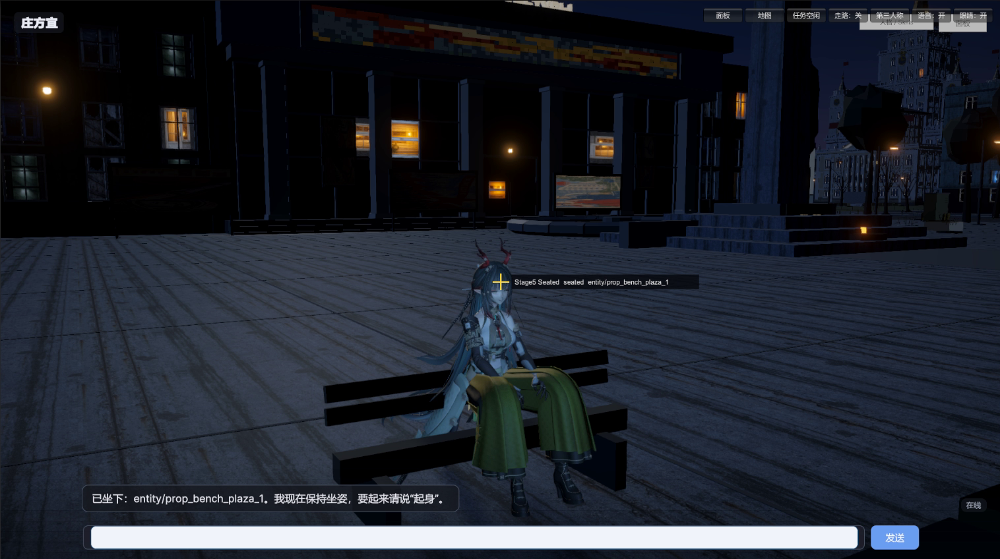<br><b>行动</b>：走近长椅、对齐并坐下。</td>
<td>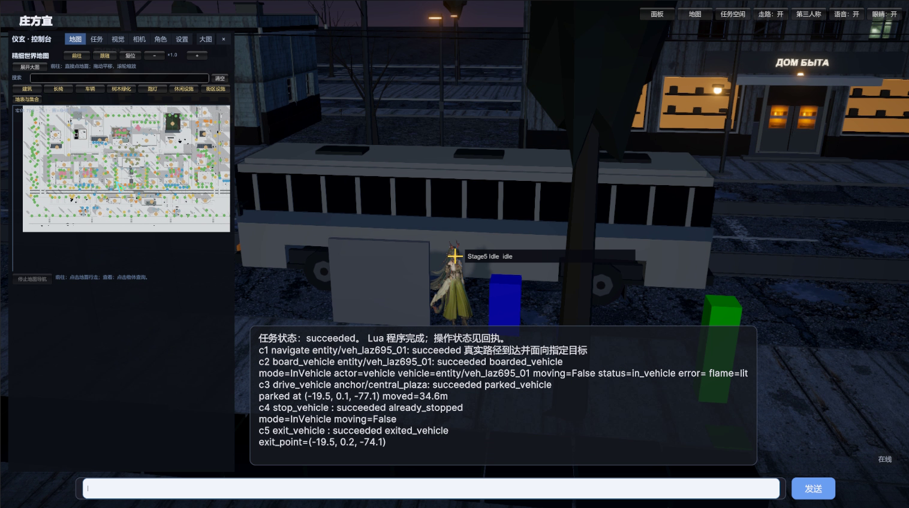<br><b>结果</b>：依据任务回执说明完成情况。</td>
</tr>
</table>

| 玩家输入 / 操作 | 希望获得的体验 | 系统应给出的反馈 | 当前状态 |
|---|---|---|---|
| “选中左边的红色立方体。” | 用日常描述指向画面里的具体物体 | 对准、高亮、确认身份 | 白盒真实样本 |
| “走到广场长椅02旁边坐下。”随后“起身。” | 把场景家具变成可使用对象 | 到达、对齐、坐下与恢复站立 | 苏联地图真实样本 |
| “走到公交01旁边，上车，开到中央广场，停车，下车。” | 一句话安排有限的多步任务 | 各步骤完成和最终停车/下车事实 | 具名任务真实样本；镜头仍有遮挡 |
| 请求画面里不可见的目标 | 得到清楚的失败，保留控制权 | 不拿旧目标冒充本次结果 | 独立负例样本；不等于所有不存在目标都能拒绝 |
| 行动中聊天 / 暂停做动作再继续 | 角色能回应又保持原来的事情 | 身体任务与对话分开，恢复剩余路径 | 已有机制和受控验证，真实语义覆盖仍有限 |

这些任务的价值在于把语义、空间和执行接在一起。坐下或开车本身并不自动产生乐趣；后续仍要设计玩家目标、角色动机、选择后果和节奏，才能形成可持续玩法。

## 3. 把体验要求拆成功能规则

### 3.1 交互循环

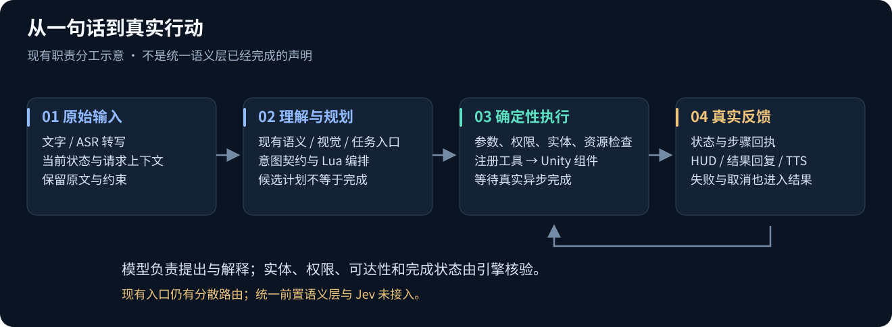

从玩家角度，过程应是“我提出要求→角色表现出正在处理→世界发生变化→我理解结果”。从系统角度，需要分别记录请求、观察和实际执行，避免回答领先于事实。

| 体验要求 | 对应功能 | 失败时应该怎样表现 |
|---|---|---|
| 说完尽早知道角色收到了 | 输入/处理状态；分段文本与语音 | 明确等待，不提前声称已找到或到达 |
| 指令中的对象不被换掉 | 实体 ID、确认记录、任务内引用 | 没找到就停在对应阶段 |
| “只看不走”能保留 | 契约禁止项、相机/身体/位移分开 | 拒绝越权动作，不默默增加移动 |
| 多个步骤按要求发生 | 顺序约束、等待异步回执 | 部分失败时说明完成到哪一步 |
| 对话不破坏行走 | 行动与对话分车道；动画资源保护 | 不因新聊天停止路径或切成思考姿势 |
| 取消以后真正停下来 | 本地停止、任务代次、迟到结果隔离 | 旧回包不恢复动作、不播过期成功 |
| 新场景不必重写交互 | 地图/实体/能力数据与通用工具分开 | 缺能力或路径就给明确失败 |

### 3.2 为什么保留 HUD 与白盒

角色自然度还不够成熟时，更需要让问题可定位。HUD 展示角色位置、选中实体、任务与视角状态；白盒隔离颜色、遮挡、相似实例和观察点，帮助区分识别错误与执行错误。

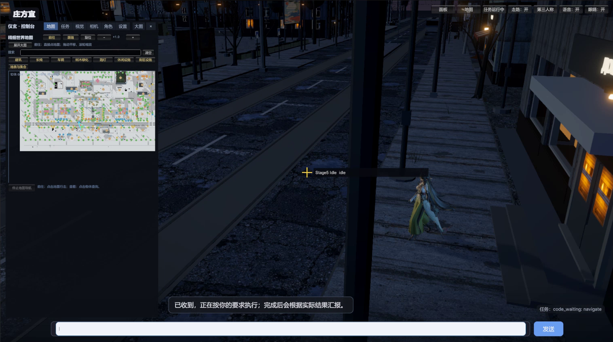

HUD 是开发和验证界面，目前不等于最终面向玩家的 UI。后续需要减少内部 ID/坐标占屏，把玩家最需要的目标和状态放在前面；诊断信息保留为可展开层。

## 4. 案例一：“看见了”不等于“选中了”

### 体验问题

玩家说“选那辆车”，希望角色选到画面中指的对象。模型生成“车在左边”不能直接成为后续移动的目标；外观、实例身份和世界位置需要分别确认。

### 可行方案与取舍

| 方案 | 优势 | 本项目遇到的边界 |
|---|---|---|
| 把所有物体 ID/坐标交给语言模型 | 地点推理直接，适合已知目录 | 目录里有不代表当前看得见；不能用它冒充视觉 |
| 模型直接估计三维位置 | 接口表面简单 | 深度、坐标系和相机变化难保证一致 |
| 视觉点框 + 引擎实体确认 | 模型负责语义，引擎负责空间事实 | 仍需解决语义错认、遮挡和过期帧 |

当前采用第三种。模型仅从原始 RGB 判断二维位置，Unity 用同帧 ID/depth 绑定目标，然后真实转动 Eye，再抓新帧中心确认。

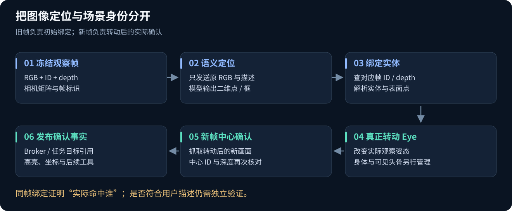

### 反馈为什么这样设计

高亮让玩家立即发现“选错了哪一个”；ID、坐标与距离帮助验证来源。玩家层不一定永远需要看到内部 ID，但设计和调试必须能够追踪它。

<table>
<tr>
<td width="50%">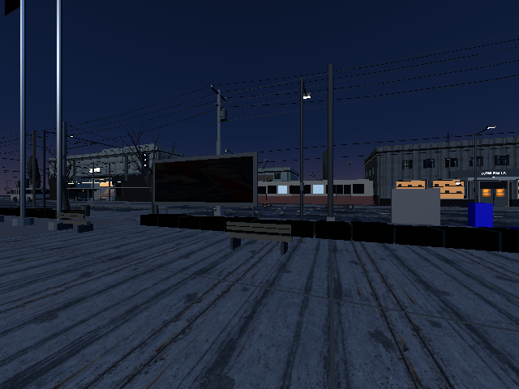<br>模型理解外观与位置。</td>
<td width="50%">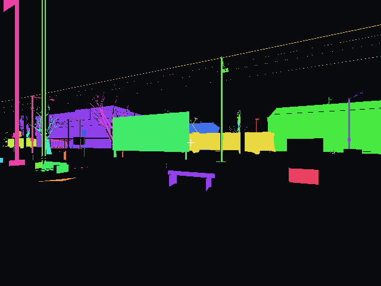<br>引擎确认对应的实例。</td>
</tr>
</table>

*同一份历史采集的 RGB 与 ID 示意。彩色 ID 缓冲不是给模型的答案，也不证明它理解了目标语义。*

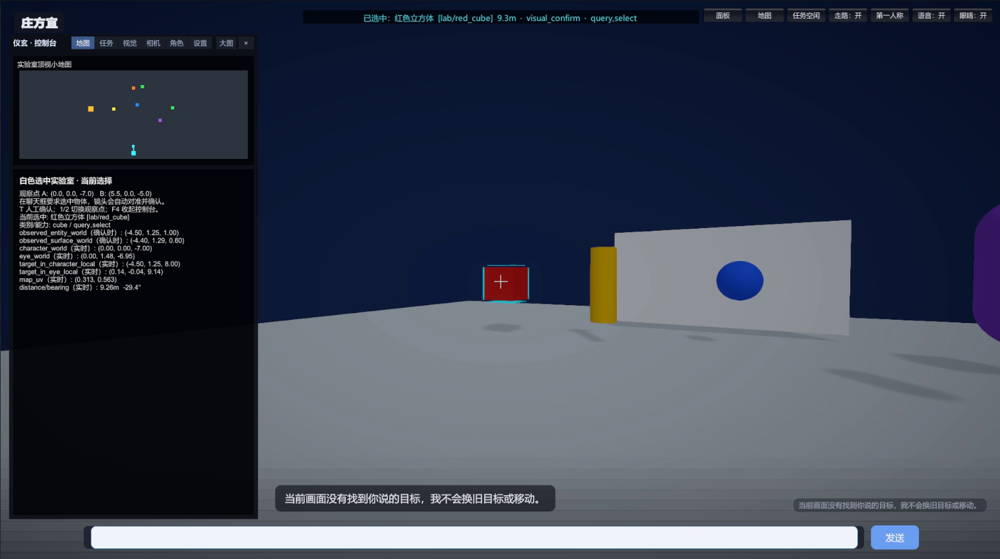

这张负例图也暴露了反馈设计问题：本次已经拒绝，但顶部仍保留上一轮选择。后续应分别呈现“本次请求结果”和“此前选中的对象”，并在失败后明确后续行为是否暂停。这样玩家既不会丢失旧选择，也不会把它误当成本次成功。

### 没有解决完的问题

历史真实测试曾把不存在的“粉色大象”匹配到紫色胶囊，随后移动约 4.48 m。这个反例说明“绑定到了真实物体”仍可能语义错认。后续回放能拒绝原响应，但没有替代真实模型重验。

因此验收需要同时问：“有没有确认到一个实体？”和“这个实体是否符合用户要求？”任何一项失败都不能算完整成功。

实现入口：[视觉服务](unity/Assets/Scripts/Selection/FirstPersonTargetingService.cs)、[PickService](unity/Assets/Scripts/Selection/PickService.cs)。

## 5. 案例二：把选物变成后续行动的起点

### 体验问题

玩家不只想把物体框出来，还会说“过去坐下”“再回刚才那个旁边”。系统需要把同一个对象从视觉确认交给任务执行，而不是每一步重新猜目标。

### 交互规则

| 阶段 | 需要确认的事情 | 不能混用的概念 |
|---|---|---|
| 指认 | 当前到底是哪一个实体 | 外观相同 ≠ 同一个实例 |
| 接近 | 有没有合法接近点和可达路径 | 表面点/pivot ≠ 可站立位置 |
| 交互 | 有无坐下/上车等能力，状态是否允许 | 能选中 ≠ 能做所有动作 |
| 完成 | 实际控制器有没有完成状态切换 | 发出命令 ≠ 已经完成 |
| 恢复 | 起身/下车后能否恢复行走 | 动画结束 ≠ 全部资源都已释放 |

<table>
<tr>
<td width="50%"><br>落座：身体姿态与座椅状态需要一致。</td>
<td width="50%">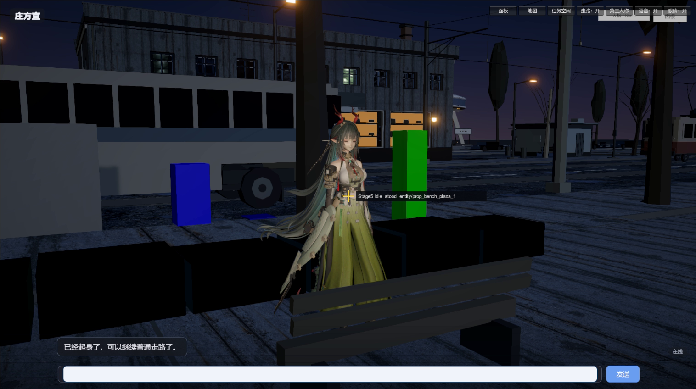<br>起身：恢复到后续可行走状态。</td>
</tr>
</table>

这次实录的座椅与公交任务证明了有限场景下的工具衔接。它们不证明“任意视觉指代都能稳定坐下或开车”；尤其公交任务由具名请求发起，和“先视觉选中哪辆车”的验证应分开。


### 怎样扩展新物件

新增交互时，应补充对象能力、接近点、占用状态、工具接口和失败回执，再设计自然语言到该能力的映射。这样家具、载具和场景装置可以复用任务框架，避免为每一句话写一套独立执行逻辑。

实现入口：[座椅控制器](unity/Assets/Scripts/Stage4/Stage4SeatController.cs)、[动态实体](unity/Assets/Scripts/Dynamic/DynamicEntities.cs)。

## 6. 案例三：选 A、选 B，为什么会忘记 A

### 体验问题

界面高亮一个“当前选择”很自然，但任务可能说“先选 A，再选 B，最后回到 A”。如果全系统只有 `Current`，B 会覆盖 A，复合任务就丢失了原先意图。

### 方案

将三种状态分开：

| 状态 | 表达什么 | 有效范围 |
|---|---|---|
| 当前画面 | 这次看到了什么 | 对应帧、相机与观察时刻 |
| 当前选择 | HUD 此刻强调哪个对象 | 用户界面与共享选中状态 |
| 任务内目标引用 | 本任务确认过哪些目标 | 对应任务、目标槽、确认来源和有效实体 |

Lua 可等待工具使“选中完成”成为一个真实阶段。选 A 确认后保存 A，选 B 后仍保留 A；再次使用 A 前检查任务、实体与授权。任务内部换选和用户外部换选/取消采用不同规则。

### 验证口径

目标槽、句柄、账本和可等待视觉工具已有实现；连续选择、移动后新帧、复用旧目标有真实局部成功。上一轮连续多目标编排在三轮返修后仍未整体验收，不能把几张成功截图写成整条链已可靠。

实现入口：[TaskSelectionLedger](unity/Assets/Scripts/AI/Tasks/TaskSelectionLedger.cs)、[可等待视觉工具](unity/Assets/Scripts/AI/Tasks/TaskMissionRunner.TaskVisual.cs)。

## 7. 案例四：聊天、临时动作与继续原任务

### 体验问题

角色正往广场走，玩家问一句话，不应该无意停止行走；玩家要求“先停下挥手，再走完”，又需要真正暂停并恢复同一条路。

历史实现出现过两类冲突：新聊天的清理逻辑把电机停了；思考动作覆盖走路动画，导致角色保持思考姿势向前滑动。另一个问题是聊天直接发起的移动没有父任务，不能进入已有暂停/插入框架。

### 方案与状态规则


- 闲聊走独立对话车道；不自动替换身体任务。
- 聊天发起的单目标锚点导航可以被任务框架承接，继续使用原路径。
- 临时静止动作保存父任务的剩余路径与路点，完成后再恢复。
- 明确停止或换目标使旧任务/恢复代次失效；不能在迟到结果到达时重新开走。

这套规则已有受控运行时测试。其重点是路径、动画资源和生命周期能否保持；语义分类替身通过，不能直接换算成真人表达识别率。某些坐标型导航或更复杂插入仍有边界。

实现入口：[导航承接](unity/Assets/Scripts/AI/Tasks/TaskMissionRunner.NavAdoption.cs)、[任务插入](unity/Assets/Scripts/AI/Tasks/TaskMissionRunner.Interruption.cs)。

## 8. 案例五：语音体验需要处理整条链路

### 不只关注模型响应时间

玩家经历的是收音结束判断、ASR、语义判断、模型输出、TTS、播放等全部环节。流式 API 可以减少串行等待，仍需考虑播报是否过期、取消是否及时和口型是否对应实际声音。

```text
麦克风 → Silero VAD → SenseVoice ASR → 语义入口
文字输入 ──────────────────────────┘
                   ├→ 任务执行 → 真实回执
                   └→ 流式回复 / 分句 → TTS → 播放与口型
```

| 方案取舍 | 体验上的原因 | 需要继续验证 |
|---|---|---|
| VAD / ASR 放在本地 sidecar | 输入阶段可以独立调试，转写问题不必和任务执行混在一起 | 结束判断、噪声、口音与回声 |
| 文本分句与音频分块流水 | 尽早播放有效内容，减少等待全文和整段合成的串行时间 | 首个有效反馈与首声延迟，不能只测模型首 token |
| 短确认与完成播报分开 | 先让玩家知道已收到，完成后再报告实际结果 | 确认语不能提前暗示已找到或已完成 |
| 按对象和轮次打断 | 停止说话、暂停身体与取消任务有不同范围 | 旧事件不清理新轮次；任务旁白与空闲对话分别测量 |

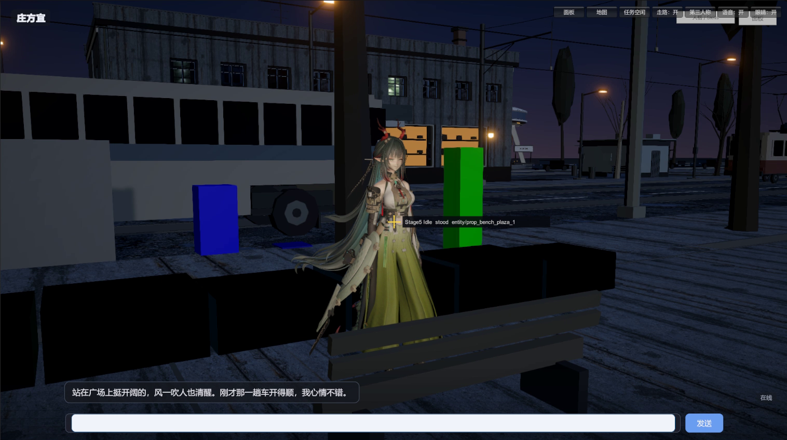

*本次素材使用文字输入与真实 TTS，不冒充真人麦克风 ASR。单张图不能证明声画同步，播放事实需结合音轨与事件记录。*

### 一个具体问题：长语音为什么读到一半就停

曾有 25.632 秒音频只播放约 8.16 秒。问题来自“回复生成后须在 10 秒内开始”的约束被错误地用作“播放全程持续有效”的条件；合成耗时也被计入。

处理方式是分开**开始期限**和**播放中的持续有效性**：过期内容不能迟到开口，已经合法开始的长音频可以播放完；用户打断、任务失效或关闭语音仍然立即取消。这比单纯延长一个超时值更符合体验要求。

### 当前表现边界

TTS、字幕和基础口型有真实样本；口型按实际音频开合，并非逐音素同步。表情、动作过渡、镜头与自然交流还需打磨。下一轮需要围绕等待提示、动作衔接、注视反馈和镜头可读性进行体验迭代，并用同一任务前后对照。

实现入口：[TaskSpeechQueue](unity/Assets/Scripts/AI/Tasks/TaskSpeechQueue.cs)、[语音 sidecar](voice/README.md)。

## 9. 案例六：把场景美术变成可交互空间

### 体验问题

地图里的路、长椅和车辆，必须有游戏逻辑可以使用的数据。只有漂亮模型，角色仍可能不知道哪里能走、哪把椅子可坐、道路表面有多高。

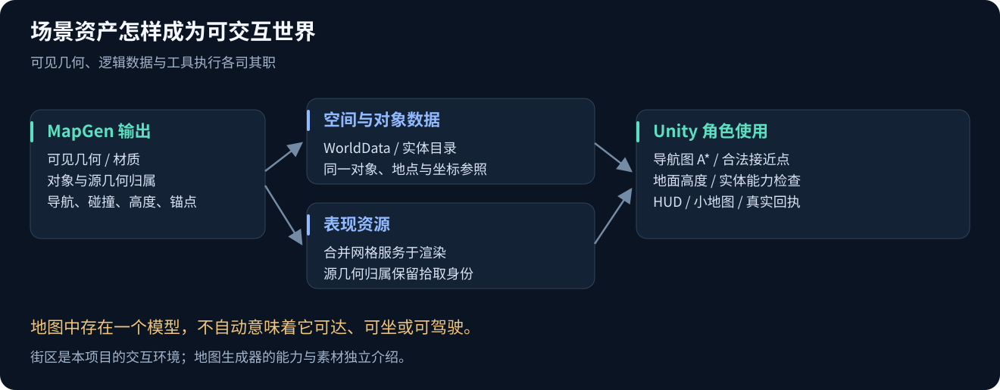

当前地图把可见几何与逻辑数据分别导出：合并网格服务于渲染；实体 ID 与源几何归属服务于对象拾取；碰撞、导航图和高度数据服务于行走；中文语义锚点服务于地点表达。

| 设计取舍 | 原因 | 边界 |
|---|---|---|
| 使用现有 A* 导航图与明确锚点 | 让位置、路径与到达可核验 | 不等于通用具身探索或动态避障全部完成 |
| 保留合并网格的实体归属 | 兼顾渲染与对象身份 | 未知几何不能伪装成可交互实体 |
| 用高度数据接地 | 覆盖草地与铺装高度差 | 台阶/平台等需符合当前通行数据 |
| 白盒与大地图同时保留 | 白盒定位机制问题，大地图暴露遮挡与空间复杂性 | 白盒成功不代表复杂场景泛化 |

角色接入同样要求实际验证。历史仪玄模型的腿部控制骨不带蒙皮权重，单看骨骼旋转会误判动作已生效。项目按模型采用 D 骨直接映射或绑定姿态增量桥接；当前庄方宜直接映射 D 骨，桥接保留给回退模型。检查实际蒙皮输出，才能判断玩家看到的行走与坐姿是否正确。

配套工具：[MapGen](https://github.com/wbcyyds123321/-MapGen)。本文展示其生成场景中的数字人交互。

## 10. 尚未解决：同一句话被不同模块解释

以下指令仍有确定反例：

> 请选中蓝色球体，然后描述选中的物体。
>
> 请选中蓝色球体，然后解释选择结果。

原本希望保留“执行选择”和“之后报告”两个意图；当前某些入口会把后半句看成评价或聊天，覆盖前半句执行意图。失败发生在视觉调用之前，更换视觉模型无法直接解决。

下一步考虑在语言输入后增加结构化语义层：保留子句原文依据，表示动作、讨论、否定、条件、顺序、指代和结果报告，再交给契约与执行。先可用现有 LLM 做结构化提取；Jev 只是有限判断问题的候选，不是替换全部模型的既定方案。

**统一前置语义层与 Jev 尚未集成。** 只有在同一中文/ASR 样本集上，准确性、误执行、漏执行、约束保留、延迟和成本有收益，才值得增加调用。

详细讨论：[语义方案](docs/semantic-decision-plan.md)。授权约束的执行校验、实体有效性、同帧数据、可达性、资源占用与本地急停仍由确定性代码处理。模型若漏掉原文的否定或子句，运行时守卫不能自动补回它们。

## 11. 如何验收准确性、控制感与体验

下面是验收设计，不是全项通过清单。

| 维度 | 代表用例 | 要核对什么 |
|---|---|---|
| 复合意图 | “选中它，然后解释结果” | 执行和报告都保留，不被聊天覆盖 |
| 否定/讨论 | “不要走”“如果选中会怎样” | 不应执行的输入不会触发行动 |
| 目标身份 | 两个相似对象 | 用户描述、最终高亮和实际 ID 是否一致 |
| 多目标复用 | 选 A → 选 B → 再用 A | 顺序成立，A 没被 Current 覆盖 |
| 重新观察 | 转头/移动后找 B | 使用新帧，不拿旧图坐标继续 |
| 取消/迟到 | 执行中停止，旧请求后返回 | 不再移动、不恢复旧任务、不播过期成功 |
| 交互完成 | 坐下起身、驾驶后下车 | 控制器状态、任务回执与可恢复行动一致 |
| 语音 | 长回复、多轮打断、真实 ASR | 录音→转写→语义→TTS分别测量 |
| 玩家理解 | 第一次看目标与阶段提示 | 能否说清角色在做什么、哪里失败 |

### 测量方式

分别记录误执行、漏执行、约束丢失、完成率、停止响应、各段延迟和模型调用量。区分首次尝试与重试，记录 pass / fail / blocked / pending；被服务额度阻塞不算通过。

真实模型与注入测试分开：注入适合稳定复现状态机和迟到事件，真实模型适合验证语义与视觉；真人麦克风还需额外考虑口音、噪声与回声。测试数量、编译结果和 HTTP 200 都不能代替玩家体验验收。

## 12. 当前交付、改进优先级与未来方向

| 优先级 | 任务 | 验收标准 |
|---|---|---|
| P0 | 修正复合语义的作用域，保留执行与报告 | 用已失败近邻句及否定/讨论对照验证，不靠扩大关键词表掩盖 |
| P0 | 补连续任务与真实迟到回包验收 | 保留原始失败，真链与注入分别出结论 |
| P1 | 改善反馈、动作过渡、镜头与等待感 | 玩家能理解阶段，角色表现更连贯；不靠假语音遮掩等待 |
| P1 | 形成可复用的小任务设计集 | 每个任务有目标、前置条件、失败、取消和完成定义 |
| P2 | 多角色长期状态与社区玩法 | 独立经历、关系与信息来源能影响后续行为 |

未来可从三个角色的小场景验证“约定与信息传播”：玩家把时间地点告诉 A，A 与 B 发生可追踪交流后，B 才知道；没有获知的 C 不知道。随后再考虑日程和关系。这需要持久状态与来源记录，当前未实现。

Agentopia 为长期角色状态和活动循环提供参考；不宣称复现其训练结果或社会模拟。外接 Agent 热更新、游戏内生成资产与程序仍是远期设想，不放进当前成果。

### 个人贡献怎样被检查

| 工作 | 可检查的产物 |
|---|---|
| 体验与规则设计 | 本策划案中的输入、条件、反馈、取消和失败定义 |
| 系统方案与接口取舍 | 意图契约、任务工具、目标账本、地图数据与模型/执行分工 |
| 工具流程整合 | 白盒实验室、HUD、MapGen 配套与运行回执 |
| 测试与迭代 | 保留的失败结论、局部成果与后续验收项 |

代码与部分美术由 AI 辅助完成，第三方角色/动作/音色按来源使用；不把所有内容都表述为本人原创。这个项目希望展示的是：把模糊体验要求拆开、做出原型，再用事实修正方案的能力。

---

[返回项目首页](README.md) · [技术架构](docs/architecture.md) · [本次证据与边界](docs/progress-2026-11-16.md) · [截图来源](docs/showcase-evidence.md) · [历史进展](docs/progress-2026-11-12.md)
