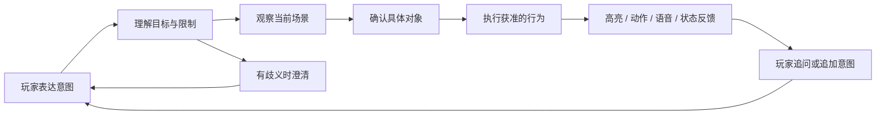
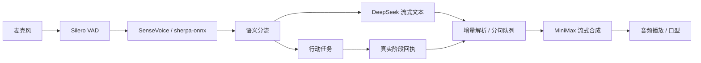
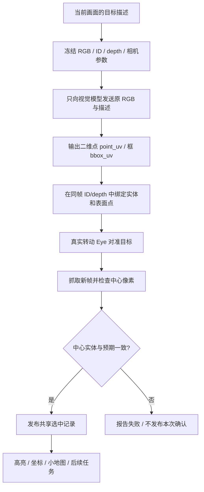

# 从一句话到场景行为：AI 数字人交互策划案

> 项目立项、体验目标、功能拆解与方案取舍 · 更新于 2026-11-12
>
> 这份文档从游戏策划角度解释：为什么做这个项目，玩家需要什么体验，需求怎样变成功能，以及技术方案怎样支撑这些功能。工程结构见[主 README](README.md)和[架构总览](docs/architecture.md)，实际验证范围见[最新进展](docs/progress-2026-11-12.md)。

**希望做出的体验：玩家用自己的话提出意图，角色能结合眼前的场景，找到对象、采取行动，并让玩家看懂过程和结果。**

例如，玩家可以提出“看看眼前有没有车，选中它，告诉我在哪里”。系统需要完成的远不止生成一句“有车”：它还要理解“只看还是要走过去”，在真实画面中定位，确认是哪辆车，再给出与场景一致的反馈。

当前成果是一个 Unity 三维数字人交互原型。单次视觉选中已有真实闭环，连续任务已有局部样本；完整的社区生活玩法、稳定的任意组合指令和多角色社会仍在后续范围内。

[立项与定位](#1-立项为什么从数字人交互切入) · [需求拆解](#3-体验目标怎样拆成功能) · [空间与选物](#5-从看见一个物体到真正选中它) · [动作编排](#6-选中以后如何接上行动) · [迭代取舍](#9-开发过程中的问题与方案调整) · [阶段交付](#11-阶段交付与后续玩法)

## 1. 立项：为什么从数字人交互切入

### 核心问题

本项目关注的是游戏角色的交互能力：玩家说出的“那个”“走近一点”“转过去再看看”，怎样落到三维世界里的具体对象和动作上。

如果只有对话，角色容易在语言里表现得理解了，场景却没有变化；如果只提供固定按钮，玩家必须先学会系统规定的表达方式。项目希望保留自然语言的表达自由，同时把实际行为约束在角色已有的能力之内。

### 项目定位

| 项目要素 | 策划定义 |
|---|---|
| 交互主体 | 玩家与一个可观察、可移动、可执行动作的三维 AI 角色 |
| 当前载体 | 复杂社区地图与独立白盒实验室 |
| 核心输入 | 文字、语音、明确的 HUD 操作 |
| 核心反馈 | 对话/语音、视角变化、角色移动、动作、目标高亮和状态显示 |
| 当前目标 | 验证“听懂意图—理解场景—执行行为—反馈事实”的交互底座 |
| 潜在应用 | RPG 陪伴角色、社区 NPC、自然语言委托和探索协作；属于后续应用方向 |
| 规模选择 | 先解决单个角色的可靠交互，再扩展到多个角色的记忆与状态联动 |

### 三条设计原则

1. **交互要在场景中成立。** “选中了”“走到了”需要对应实体确认或移动回执。
2. **玩家保留控制权。** “只看不走”、否定、取消和任务顺序都是需求的一部分。
3. **过程应当可理解。** 玩家能分清角色在等待服务、正在行动、已经完成，还是需要补充说明。

### AI 与交互规则怎样分工

模型负责理解开放表达、提出计划和定位图像目标；策划需要定义角色有哪些能力、每个行为的前置条件、冲突优先级与失败反馈；引擎维护真实状态并执行。表达可以开放，行为仍有明确规则。这样的分工让新说法有机会映射到既有能力，也让玩家能预期一个动作会产生什么结果。

## 2. 核心体验：表达意图，观察行动，得到可追问的结果

设计上的交互循环如下；其中连续任务仍在完善，并非整条链路已经稳定验收。



| 体验片段 | 玩家希望发生什么 | 系统必须分清什么 | 当前情况 |
|---|---|---|---|
| “眼前有没有车？选中它。” | 找到可见车辆，视角对准并高亮 | 看见的对象与目录里的对象；定位与确认 | 已有车辆单图视觉选中的真实样本 |
| “走到广场去。” | 角色沿可行走路径到达 | 地点、路径、当前位置与实际到达 | 已有地图导航链路 |
| “走过去时和我聊两句。” | 对话不破坏正在进行的移动 | 语音轮次与身体任务的生命周期 | 已有双车道及保护逻辑，长期体验仍需验证 |
| “先选 A，再选 B，然后回到 A 附近。” | 多个目标和顺序持续有效 | A/B 独立引用、新观察与旧目标复用 | 编排机制已实现，真实局部通过，整体待验收 |
| “选中它，然后解释选择结果。” | 执行后再说明 | 执行意图和报告意图可以同时存在 | 存在被误判为聊天的反例，当前重点优化 |

这套底座最终能支撑自然语言委托。但“能够执行一些工具”还不足以构成完整游戏；任务目标、角色关系、奖励和循环节奏需要在后续玩法设计中补齐。

## 3. 体验目标怎样拆成功能

| 体验需求 | 功能要求 | 本项目采用的办法 | 进度与边界 |
|---|---|---|---|
| 说完后尽早得到回应 | 缩短第一句有效反馈的等待 | 本地 VAD/ASR、LLM SSE 增量输出、分句队列、流式 TTS | 已有链路；不把一次服务耗时当整体延迟指标 |
| 角色知道自己在哪里 | 场景坐标、地点、可走区域一致 | 世界数据、语义锚点、导航图、碰撞数据、地面高度图 | 已接入当前地图 |
| 玩家理解角色要去哪里 | 可视化位置、朝向和目的地 | 小地图、附近地点、点击导航、统一 HUD | 已实现相关界面和数据接入 |
| “这辆车”对应真实对象 | 实例身份不能随外观混淆 | 实体目录、稳定 ID、源几何映射、实时对象状态 | 拾取链已接入；不等于语义识别永远正确 |
| 角色确实看见并选中目标 | 图像定位必须绑定到场景 | 原 RGB → 模型点/框 → 同帧 ID/depth → 转向 → 新帧中心确认 | 单次真实闭环有样本 |
| 选中后能继续交互 | 目标、能力、接近位置和动作关联 | 共享选中记录、能力校验、路径检查、注册工具 | 有基础工具；各类交互验收范围不同 |
| 一句话能安排多个动作 | 顺序、等待、条件、目标复用可表达 | 独立意图契约、Lua/MoonSharp、可等待工具、目标账本 | 已实现机制；组合语义和连续链待完善 |
| 能打断且不串轮 | 区分停说话、停移动、换任务 | 轮次/代次标识、播放 token、取消和资源保护 | 有受控验证；真实声学与迟到回包仍有待验项 |
| 角色反馈可信 | 只报告实际完成的步骤 | 工具回执、阶段事实摘要、共享选中事实 | 已有实现，持续核对覆盖范围 |
| 社区角色各有经历 | 独立人设、长期记忆和信息来源 | 后续设计记忆、关系、日程和事件传播 | 计划阶段 |

## 4. 及时回应：低延迟是一条链路的设计

### 从体验提出要求

玩家等待的不只是模型回答，还包括收音结束、识别、语义处理、网络请求、语音合成和播放。只替换一个“更快的模型”，不能解决所有等待。

因此当前采用可拆分、可观察的级联方案：



图中是现有模块及其设计关系；任务结果播报仍需逐条确认对应的回执和轮次，不能因已接通 TTS 就认定所有行动反馈都正确。

### 方案取舍

- **语言模型**：当前发布配置使用 `deepseek-flash`。选择快速响应路线，语言理解、计划和结果表达按职责组织；是否满足体验要求仍要用项目样本评估。
- **文本与语音流水**：可用文本分句后进入 TTS，音频分块就绪后开始播放，减少等待全文生成和整段音频合成的串行时间。
- **本地输入处理**：VAD 判断语音段，ASR 生成文本后进入语义处理；存在语音结束判断和识别耗时，当前仍以轮次式交互为主。
- **对话与行动分开管理**：闲聊不应把走路动画替换成思考动作，也不应无意取消导航；明确的停止指令单独处理。
- **打断按对象处理**：打断语音与取消行动不自动等价，播放队列需要隔离旧轮次和新轮次。

短确认语可以告诉玩家系统已接收请求，但不代表“目标已找到”或“任务已完成”。有效结果语音需要引用最终任务事实。

### 怎样评价低延迟

后续测量需要分别记录：说话结束到转写完成、语义决策耗时、模型首段可用内容、首个实际音频块，以及停止指令到对应行为停止。目标是降低有效反馈等待，并保持取消和结果一致性。

当前已有受控输入、播放和打断验证；真人麦克风、口音、噪声、回声、长时运行和主观听感尚需实测。本项目不以“已使用流式 API”宣称已经达到固定的毫秒级体验目标。

相关实现：[聊天与流式分句](unity/Assets/Scripts/AI/ChatSession.cs) · [LLM 流式客户端](unity/Assets/Scripts/AI/DeepSeekStream.cs) · [语音 sidecar](voice/voice_server.py) · [语音说明](voice/README.md)

## 5. 从看见一个物体，到真正选中它

### 5.1 先让地图具备交互数据

地图承担的不仅是美术背景，还要支持“哪里能去”“这是哪个对象”“可以做什么”。因此世界数据分成几个层次：

| 数据层 | 解决的问题 | 策划意义 |
|---|---|---|
| 可见几何与材质 | 场景长什么样 | 提供空间氛围、辨识度和视觉目标 |
| 实体 ID、名称、类别、几何归属 | 场景中究竟是哪一个对象 | 两把相似椅子仍是不同实例 |
| 能力与动态状态 | 这个对象允许哪些交互 | “能选中”不代表“能坐下、能驾驶、能拾取” |
| 碰撞与导航图 | 从当前位置怎样到达 | 保证行动依照可走路径执行 |
| 语义锚点 | 广场、入口等地点在哪里 | 让地点语言和路径系统使用同一参照 |
| 地面高度 | 角色怎样贴合不同铺装 | 避免视觉上的陷地和漂浮 |
| 小地图与 HUD | 玩家怎样理解上述信息 | 把角色位置、朝向、目标和执行过程展示出来 |

小地图先提供定位和导航入口；实体数据再支持对象级交互。二者共用世界数据，但小地图不作为视觉模型“看见某物”的替代证据。

源地图为了渲染效率合并网格后，一个 Renderer 可能包含多个物体。交互层因此保留源对象与实体的几何归属，避免把整栋建筑或整批网格的中心猜成目标位置。无法确认归属的几何不能伪装成可交互实体；它仍可遮挡视线。

相关实现：[世界数据](unity/Assets/Scripts/World/WorldData.cs) · [实体目录](unity/Assets/Scripts/World/WorldEntityCatalog.cs) · [几何拾取注册表](unity/Assets/Scripts/Selection/EntityPickRegistry.cs) · [地图生成工具](https://github.com/wbcyyds123321/-MapGen)

### 5.2 把“识别”拆成语义定位和实体确认

本项目采用的分工是：模型判断当前图片中的目标位置；Unity 判断这个像素对应哪个真实实体。模型不直接猜世界坐标。



**为什么要转动后再确认？** 原图中的位置可能因视角变化而过期。新帧中心确认才能证明角色此时实际对准了哪一个实体。

这里实现了“准星对准后确认命中”的交互目标，技术上采用同帧实例 ID 与深度缓冲解析；不能把它简单描述为已经新增了一次 `Physics.Raycast`。它不依赖给每个可见物体单独补一个物理 Collider 才能确认。

模型点落在背景时，已有框内恢复和歧义检查逻辑；恢复限制在模型给出的区域内。框内有多个矛盾候选时，设计要求是拒绝或澄清，不能全图寻找一个答案来凑成功。这些保护仍需真实语义样本持续验证。

### 5.3 为什么 ID 还不能解决所有识别问题

ID 能说明“最后命中了哪一个”，不能证明“这个物体就是用户要的那个”。颜色、形状和类别之间仍可能错配。

最近保留的一次真实失败中，模型把不存在的“粉色大象”关联到了紫色胶囊，随后发生了不应有的移动。这个结果说明：存在可绑定实体，不等于满足了目标语义。后续修复的本地回放能够拒绝该响应，但尚不能替代真实模型重验。

因此产品要求同时满足两件事：目标语义有依据，场景身份有确认；服务返回 HTTP 200 也不能单独作为成功判据。

相关实现：[视觉目标服务](unity/Assets/Scripts/Selection/FirstPersonTargetingService.cs) · [拾取与中心确认](unity/Assets/Scripts/Selection/PickService.cs) · [选中数据](unity/Assets/Scripts/Selection/SelectionTypes.cs)

## 6. 选中以后，如何接上行动

### 6.1 选中是一份可复用的事实

高亮让玩家看到选择结果；后续任务还需要共享同一份实体身份、确认来源、观察时间、坐标和状态。项目用 `SelectionBroker` 发布确认记录，让 HUD、回答和任务消费同一来源。

| 玩家意图 | 需要的规则 |
|---|---|
| “它在哪？” | 回答选中对象的真实位置、相对距离和朝向 |
| “靠近它。” | 解析当前实体与安全接近点，再检查路径；不能直接走到物体表面点或 pivot |
| “坐到这把椅子上。” | 检查对象能力、座位状态、接近路径，再执行注册的座椅行为 |
| “只看它，不要走。” | 可以转动获准的视角，但禁止产生移动 |
| “它已经移动了，再看看。” | 区分历史观察位置与当前 live 状态，必要时重新观察 |
| “没有找到就停下。” | 保留失败阶段，不使用上一次选中对象代替本次目标 |

表中是功能规则。坐下、车辆等已有工具或历史实现不等于本轮已完成全量验收，具体范围以[进展记录](docs/progress-2026-11-12.md)为准。

### 6.2 把选物也变成可等待的任务步骤

仅把“选物”当成独立聊天入口，会使复杂任务难以衔接。因此项目把视觉选择接入 Lua 任务运行时：一次选择结束并收到确认回执后，程序才继续后面的动作。

下面是编排意图示意，不是可直接复制执行的 Lua API：

```text
声明任务目标槽 A、B 和允许的动作
    → 观察并选中 A，得到确认后的任务句柄 A
    → 走近 A，等待移动回执
    → 按指令转动身体或 Eye
    → 从新画面选择 B，得到任务句柄 B
    → 再引用 A 执行获准动作
    → 根据实际完成的步骤汇报
```

这里需要区分三个概念：

- **观察画面**：二维点框只属于对应帧，不能套在转动后的新帧上。
- **UI 当前选择**：界面可以只高亮一个对象。
- **任务内目标引用**：任务可以保留 A、B 的独立句柄，选择 B 不应自动遗忘 A。

### 6.3 为什么采用契约 + Lua + 注册工具

| 方案 | 取舍 |
|---|---|
| 为每一种说法写固定分支 | 容易启动，但同义句和动作组合增长后难以维护 |
| 让模型直接控制任意场景代码 | 表达自由，但授权、取消、对象身份和结果核验难控制 |
| 当前路线：意图契约 → Lua → 注册工具 → 回执 | 用程序表达顺序和等待，用运行时限制实际能力，并让结果可追踪 |

契约记录玩家真正授权的目标、动作、顺序和限制；Lua 编排已注册工具；静态检查和运行时守卫核对行为。模型生成的动作名称不能自动变成新能力。

已接入的机制包括可等待 `select_visible`、目标槽、确认句柄和任务内目标账本。连续选择、移动后观察、旧目标复用有真实局部样本，但尚未形成整体验收通过的连续任务能力。

相关实现：[意图契约](unity/Assets/Scripts/AI/Tasks/TaskIntentContract.cs) · [工具注册表](unity/Assets/Scripts/AI/Tasks/TaskToolRegistry.cs) · [Lua 运行时](unity/Assets/Scripts/AI/Tasks/TaskLuaRuntime.cs) · [目标账本](unity/Assets/Scripts/AI/Tasks/TaskSelectionLedger.cs)

## 7. 角色表现：语言、身体、表情需要协调

角色“做出了回应”包含多种表现：开始说话、改变表情、转头看向对象、身体转向、走路或播放动作。它们可能并发，也可能争用同一部位。

策划上需要明确动作的对象和优先关系：

- “向右看”与“身体右转”是不同意图；Eye 相机、可见头部骨骼与身体朝向也不是同一状态。
- 行走过程中聊天，应保留行走动画和位移；思考动作不应抢占正在走路的身体。
- 口型跟随实际播放，取消播放后清理旧轮次状态，避免新一句话被旧事件结束。
- 动作候选来自实际动作清单；没有的动作需要说明或替代，不能悄悄播放一个不相符的姿势。

项目已有动画播放器、动作清单、表情/口型组件及部分资源保护。统一的语言、动作、表情调度还需要完善，不能将现有分散组件描述为已经完成的统一状态机。

角色接入也直接影响交互质量：项目中的 MMD 血统模型有控制骨和真正驱动网格的变形骨，动画重定向需要适配。相应桥接与接地逻辑服务于“角色真的动起来且站在地上”的体验要求。

相关实现：[动作清单](unity/Assets/Scripts/Motion/MixamoActionManifest.cs) · [角色移动](unity/Assets/Scripts/Motion/CharacterLocomotion.cs) · [变形骨适配](unity/Assets/Scripts/Motion/MmdDeformBridge.cs) · [表情组件](unity/Assets/Scripts/Expression/YixuanExpressions.cs)

## 8. 界面设计：让玩家理解 AI 正在做什么

地图、任务、视觉、相机、角色和设置收拢到统一 HUD，减少多个面板重复控制同一功能。展示目标高亮、坐标和任务阶段，也让测试时能够核对“语言、界面、世界”是否一致。

| 界面元素 | 体验作用 |
|---|---|
| 小地图与角色朝向 | 理解自己的位置、附近地点和行进方向 |
| 地点点击入口 | 提供明确的导航交互，也便于和自然语言导航对照 |
| 目标高亮与实体信息 | 让玩家立即发现“选错了哪一个” |
| 任务阶段与回执 | 区分已经完成、正在执行和尚未开始 |
| 语音/视觉/视角状态 | 确认输入输出是否启用，减少无反馈时的猜测 |

实体 ID、坐标和详细回执主要服务于当前原型验证。面向正式玩家时，可保留名称、高亮、阶段提示和失败原因，把技术字段折叠到调试视图；这是后续界面方向。

界面实机展示见[主 README](README.md#实机展示)；相关实现见[统一 HUD](unity/Assets/Scripts/UI/UnifiedHud.cs)。

## 9. 开发过程中的问题与方案调整

这里按需求逐步扩展的关系整理，不把它当作完整的开发时间线。

| 原需求 / 暴露的问题 | 调整方式 | 策划上的收获 |
|---|---|---|
| 地图可看，但角色不知道哪里能去 | 导出碰撞、导航、地点和高度数据，加入小地图入口 | 场景需要可供行为消费的数据层 |
| 合并网格后不能可靠区分具体物体 | 保留源几何归属与实体 ID，再建立拾取映射 | 渲染优化不能抹掉交互对象身份 |
| 模型说找到了，但无法确认命中对象 | 二维点框与同帧 ID/depth 绑定，转向后再次确认 | 语义观察与空间确认需要各自的证据 |
| 选中只显示高亮，后续行为引用不一致 | 发布共享确认记录，区分表面点、物体位置和接近点 | 一个交互结果应能被多个系统一致复用 |
| 多次选物互相覆盖、动作无法连续等待 | 让视觉选择成为 Lua 步骤，引入独立目标槽和任务账本 | 把选物纳入行动编排，而非额外聊天捷径 |
| 对话打断移动或抢走走路动画 | 分离对话和行动生命周期，增加身体资源保护 | “可以同时说和做”需要明确控制权 |
| 复杂场景中难分辨错误来源 | 建立复用主链路的白盒实验室 | 控制变量后再判断语义、视觉、绑定或执行哪里出错 |
| “选中后解释”被整句当成聊天 | 下一步统一语义表示，并评估 Jev | 新模型是候选手段，作用域和接口一致性也必须修 |

白盒实验室包含 7 个几何体实例、外观相同但 ID 不同的对象、遮挡负例和多个观察点。它保留正式地图的选择链路，用于有针对性的验证；它不是任意视觉类别都已识别成功的证明。

### 下一步为什么评估 Jev

目前一个明确瓶颈是各模块对同一句话反复解释，后置的“解释结果”可能覆盖前置的“执行选择”。因此准备先统一表示执行、报告、否定、条件、顺序和指代，再比较现有路由、统一 LLM 路由与 Jev 辅助判断。

Jev 的拟议职责是回答边界明确的判断问题，而不是直接控制 Unity。授权、目标有效性、空间确认、路径可达、取消和完成仍由确定性代码负责。同一状态的独立判断应考虑合并，避免为每个分支串行增加一次请求。

**Jev 尚未接入。** 是否采用取决于中文样本的误执行、漏执行、约束保留、时延和调用成本；置信度不是正确率。详细方案见[统一语义决策](docs/semantic-decision-plan.md)。

## 10. 怎样判断体验真的成立

以下是策划验收方向，不是本项目已经全部通过的测试清单。

| 验收维度 | 典型用例 | 需要观察的结果 |
|---|---|---|
| 意图理解 | “选中它，然后解释结果”；“只看，不要走” | 动作和报告同时保留，限制没有丢失 |
| 空间身份 | 两个外观相同的物体 | 确认记录、高亮与实际命中的是同一个实例 |
| 目标缺失 | 画面中没有所述对象 | 不编造目标，不借用旧选择，不发生依赖它的移动 |
| 顺序与复用 | 选 A → 选 B → 再使用 A | 顺序有回执，目标引用不互相覆盖 |
| 观察时刻 | 转身后寻找 B | 使用转动后的新帧，不套用旧坐标 |
| 中断 | 行动或语音仍 active 时取消 | 对应行为停止，迟到事件不能重新启动旧任务 |
| 结果反馈 | 中途失败或只完成一半 | 准确说明完成到哪一步，不提前宣称成功 |
| 语音体验 | 真人对话、环境噪声、连续多轮 | 转写、播放、打断和轮次稳定，分别记录耗时 |

结果按 pass / fail / blocked / pending 记录；真实模型与本地注入、首次结果与重试分开。服务不可用与夹具错误单独记录原因，不能拿其他用例的成功覆盖原始失败。

当前结论是：单次视觉选中有真实成功，Lua 编排有局部成功，组合语义与连续链仍在完善；真实声学、取消后的真实迟到回包等尚有待验项。公开状态表见[最新进展](docs/progress-2026-11-12.md)。

## 11. 阶段交付与后续玩法

| 阶段 | 体验目标 | 可检查的阶段成果 | 当前状态 |
|---|---|---|---|
| 1：单角色场景交互 | 能理解、观察、选物、行动并反馈 | 明确的小任务集、约束保持、状态与真实回执一致 | 底座已有，优先完善语义与连续任务 |
| 2：角色的持续性 | 不同角色有各自经历、关系与约定 | 先做 3 个角色，验证独立记忆和有来源的信息传播 | 规划阶段 |
| 3：社区日常 | 行为不完全依赖玩家逐条下令 | 日程、目标、相遇事件和状态影响后续互动 | 后续方向 |
| 4：可扩展世界 | 新内容能够进入既有交互体系 | 受控的数据、Lua、资产更新与回滚 | 长期设想 |

第二阶段可设计一个小场景：玩家与 A 约定时间地点，A 记住并通过一次可追踪的交流告诉 B；B 后续知道约定且能说明来源，未获知的 C 则不知道。存档恢复后仍保留有效信息。

这个例子需要记忆、信息传播和关系状态，不能通过把同一段对话历史复制给所有角色来代替。未来“社区中的多个角色”也应建立在稳定的单角色执行能力之上。

## 12. 参考如何转化为设计

| 来源 | 参考内容 | 本项目的转化与边界 |
|---|---|---|
| [独立地图生成器](https://github.com/wbcyyds123321/-MapGen) | 程序化场景及数据导出 | 将地图作为交互载体，连接世界数据、地点导航与对象拾取；可见网格和交互数据分别组织 |
| [MoonSharp](https://www.moonsharp.org/) | C# 环境中的 Lua 解释器 | 用 Lua 表达步骤、等待和复用，具体 Unity 行为由注册工具提供；执行语义和守卫由项目实现 |
| [Agentopia](https://github.com/Neph0s/Agentopia) | 长期记忆、人设、目标和 Plan → Contact → Activity → Review 循环 | 后续参考其角色持续性思路；不宣称已复现其训练或长期社会模拟，也不把文字环境结果替代三维执行 |
| [Jev 官方文档](https://docs.typesafe.ai/introduction) | 对给定状态提出有类型的判断问题 | 计划评估语义分叉判断；未集成，不预设比现有方案更准确或更快 |
| 项目内的真实运行与白盒实验 | 错选、语义误路由、移动/语音冲突等具体反例 | 由反例调整需求、接口和验收，保留失败，避免只展示一次成功 |

语言、视觉和语音目前接入了 DeepSeek、SenseVoice/sherpa-onnx、Silero VAD 与 MiniMax 等模块，技术清单见[主 README](README.md#核心架构)。组件选型、交互规则、数据组织和验证方式共同决定实际体验。

---

[返回项目首页](README.md) · [技术架构](docs/architecture.md) · [最新验证状态](docs/progress-2026-11-12.md) · [下一轮语义优化方案](docs/semantic-decision-plan.md)
