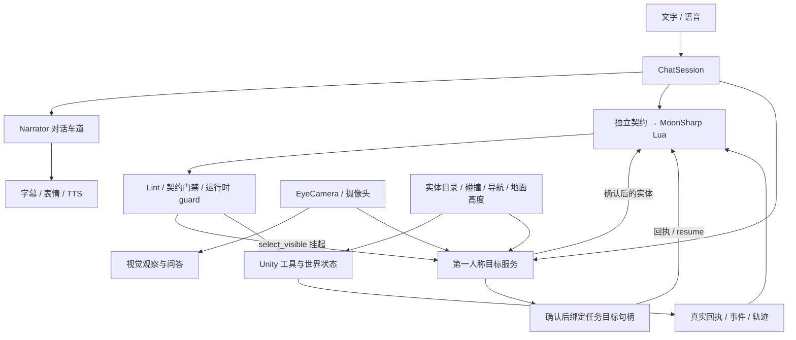
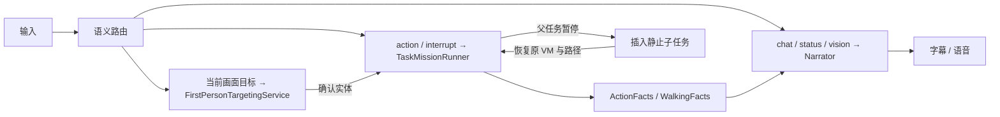
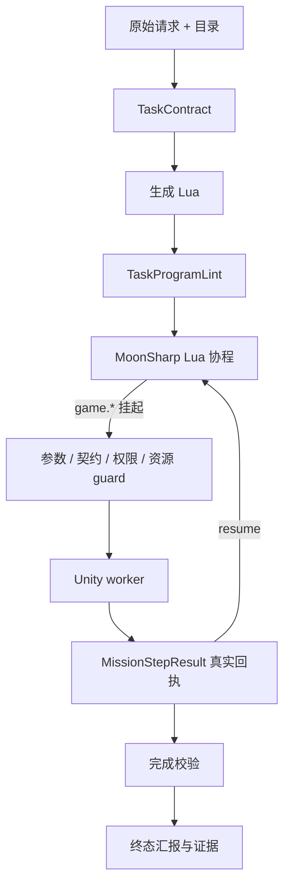
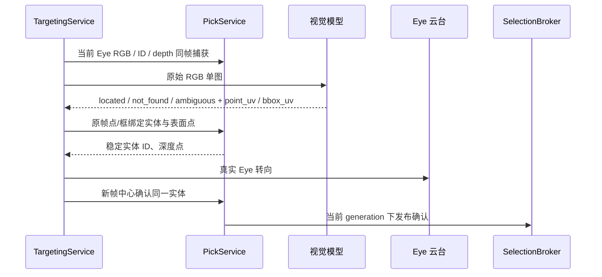
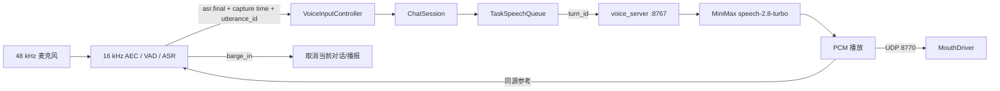
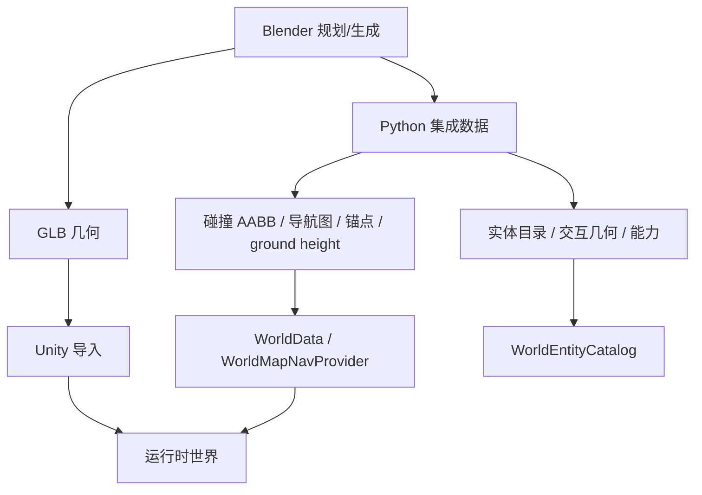

# 技术架构（2026-11-12 源码快照）

本项目把自然语言、视觉感知和可验证行动接入同一个 Unity 3D 世界。模型负责理解与规划，Unity 负责移动、转向、动作、相机和场景状态；完成与否只由真实回执判断。

这是源码展示快照，不是可直接运行的完整 Unity 工程。发布包仍需第三方包、角色/地图/音频资产和本机 API 配置；阶段边界见 [最新进展](progress-2026-11-12.md)。

## 1. 总览

用户要求、模型观察、Unity 实际状态是三类事实。契约保存第一类，视觉响应保存第二类，组件回执保存第三类；后续行动和回答不能跨类臆造事实。

## 2. 模块

| 目录 | 职责 |
|---|---|
| `unity/Assets/Scripts/AI/` | 对话、语义路由、Director、任务运行时 |
| `unity/Assets/Scripts/Selection/` | 实体拾取、RGB/ID/depth、视觉定位、确认 Broker |
| `unity/Assets/Scripts/Vision/` | EyeCamera/摄像头观察、视觉服务、云台 |
| `unity/Assets/Scripts/Voice/` | sidecar 通信、输入轮次、口型 |
| `unity/Assets/Scripts/Motion/` | 动作、导航位移、接地、MMD 骨架适配 |
| `unity/Assets/Scripts/World/`、`WorldMap/` | 实体目录、锚点、碰撞、导航、大地图 |
| `unity/Assets/Scripts/Stage4/`、`Stage5/`、`Dynamic/` | 座椅、视觉座椅、车辆和动态实体 |
| `voice/`、`map/` | Python 语音 sidecar、地图生成与数据导出 |

部分类保留历史名称（例如 `QwenVisionClient`），名称用于场景兼容；实际视觉 provider 以代码配置为准。

## 3. 语义分流与双车道

`ChatSession.Submit` 接收文字或 ASR。Auto 模式先做语义分类和显式控制（停止、静音、取消等），再分流到对话、行动、座椅/动态交互或第一人称视觉目标。任务运行、暂停或角色正走向锚点时，闲聊走 Narrator，不直接写身体状态。

行动和对话拥有独立请求、取消代次和上下文。显式“停下”优先取消行动；聊天取消只取消对话车道。走路时不会用思考动作覆盖走路动画。

## 4. 行动契约与 Lua

`TaskMissionRunner` 先独立提取 `TaskContract`，再生成程序。契约记录目标、动作、次数、顺序/重叠、条件、途中时机和禁止项；已知目标与动作来自实时目录，视觉目标先以原请求中的描述声明独立 `target_slots`，不得让模型预填实体 ID。

`return {ok=true}` 只是程序意图，不是完成证明。导航要看位置/路径/朝向，动作要看实际动画结果，座椅和车辆要看控制器状态，视觉要看服务回执；失败、拒绝、取消均保留原因。

`TaskToolRegistry` 统一工具参数、效果、资源和超时。工具包括 `select_visible`、`navigate`、`follow_route`、`return_home`、`move_relative`、`turn_body`、`look_at`、`look_direction`、`gesture`、`express`、`speak`、`observe`、`check`、`wait`、`report`、`interact`、座椅/车辆/动态实体操作和 `parallel`。`TaskAuthority` 仲裁 body/camera/voice/expression；并行批次先整体检查资源冲突。

### 任务内视觉目标

`select_visible(description, {slot=...})` 在 Lua 中挂起。运行时检查 slot 已被契约声明、描述与授权一致，再调用真实视觉链；只有发布的确认记录与本次请求匹配，才返回包含 `target_ref`、`target_slot`、`selection_confirmed` 的回执。

`TaskSelectionLedger` 保存任务内多个已确认目标：内部选 B 保留 A 的句柄，外部换选/取消、任务或场景切换及实体失效则触发相应失效检查。下游工具解析句柄而不是任意借用 `SelectionBroker.Current`。移动或转向后的新选择重新抓帧，不能在新视角复用旧 UV。

`TaskPhaseSummary` 把契约义务与真实工具回执逐项匹配；一次回执不能填满多个重复动作。阶段播报和终态来自执行结果，Lua 的成功返回不替代完成核验。

这些机制已接入，连续动作仍受语义路由已知缺陷限制，不能据此宣称任意自然语言任务都已通过。

Lua 默认限制是 96 次工具调用、2,000 个执行切片，每切片 1,000 条指令；不开放 CLR、文件、网络或动态加载。这是脚本级限制，不是操作系统级沙箱。程序只可在任何 Unity 副作用之前进行一次受控修复。

`follow_route` 保存真实 A* 路径，按路径弧长返回 progress；部分进度不算到达。插入动作保留父 Lua VM、局部变量、回执和运动快照，完成后继续剩余路径。插入只允许动作、表情、说话、等待和受限原地视线；取消/替换用代次阻止晚到恢复。聊天发起的锚点移动可由 `AdoptNavigation` 交接为同一可暂停任务，沿用未走路段。

## 5. 第一人称视觉选中

模型只看当前原始 RGB，Unity 再做身份绑定、深度与确认。实体 ID、候选框和世界坐标不作为模型答案输入。

`EntityIdCapture` / `PickFrame` 冻结 RGB、逐像素实体 ID、线性 depth、相机姿态和投影。模型输出是左上角原点的归一化 `point_uv` 与 `bbox_uv`；绑定使用同一帧坐标，不做额外的垂直翻转。深度回推区分视轴深度和斜射线距离。

`FirstPersonTargetingService` 检查坐标边界、点框一致性、可选实体、类别约束和同类歧义。点落在缝隙/背景时，只能在模型框内找唯一可靠同类候选；遮挡、歧义、矛盾或新帧中心不一致都会拒绝确认。真实瞄准后最多有限次重新捕获。

`SelectionBroker` 分开保存 pending candidates 与 confirmed record，并对新意图、手动选择和取消递增 generation，拒绝旧结果覆盖新选择。代词查询可读取当前确认；新的关系描述仍须看当前画面。Lua 已可依次调用视觉工具绑定多个任务目标；一次看图枚举所有目标、任意批量执行与任意复杂任务不在当前验收结论内。

ID/depth 绑定与新帧确认解决几何身份一致性，不能单独保证模型理解了“粉色大象”等语义约束。公开进展保留错认及移动的真实失败，后续本地门禁回放不当作真实视觉复验。

选中后的“走近它/坐下/上车”会把原请求、约束和同一实体交给契约/Lua；确认可见物体不自动授予移动或交互权限。`WhiteboxSelectionLab` 是独立白盒场景，用于检查遮挡、相对关系、绑定、瞄准和中心确认，不代表复杂地图泛化准确率。

## 6. 视觉配置

EyeCamera 与电脑摄像头是两路输入。后台观察、实时问答和第一人称定位各自有取消/过期规则，并保留原始响应和诊断。

源码默认是 `VisionProvider.DeepSeek`、模型 `deepseek-flash`、官方 DeepSeek 端点，`FallbackModels` 为空。`QwenVisionClient` 只是兼容历史类名；显式选 Qwen 才使用 Qwen 端点和回退数组。服务失败、看不清或目标不在当前画面时如实返回。

## 7. 语音轮次与 sidecar

sidecar 使用 SenseVoice/sherpa-onnx、Silero VAD 和 AEC；`8766` 是独立 TTS 服务，`8767` 处理双工输入/播放。`TaskSpeechQueue` 管理排队、合成、首音频确认、完成和取消；开始期限只约束开始播放之前，长音频开始后可正常播完。

Unity 与 sidecar 以 `service_id`、`turn_id` 和 token 绑定播放。服务重启、旧响应、旧取消和旧事件不会复活旧轮次；ASR 保留来源、捕获时间和 utterance ID，UI 时间栅栏与去重过滤晚到事件。真人 ASR、口音、环境噪声、扬声器回声和长期稳定性仍待真实设备验证。

## 8. 世界、导航与身体

地图数据遵循 Blender `(x,y,z)` → Unity `(x,z,y)`。`WorldData` 通过障碍、A* 导航和语义锚点支持大地图移动；`GroundSnap` 从地面高度图按当前位置修正角色 Y。地图几何变化后必须同步重建碰撞、导航、实体和 ground height 数据。

动作 ID 从 `MixamoActionManifest` 读取。`CharacterLocomotion` 负责水平移动与路径所有权，`CameraDirector` 负责展示相机，`EyeGimbalController` 负责眼视方向。MMD 模型若 Humanoid 映射到控制骨，`MmdDeformBridge` 在 `LateUpdate` 用序列化 rest pose 将控制骨增量施加到 D 骨；已直接映射 D 骨的模型无需重复桥接。角色没有 Rigidbody/CharacterController，接地由 `GroundSnap` 负责。

## 9. 证据与边界

任务可记录契约、Lua、lint、调用、回执、事件和轨迹；选中可记录原图、同帧 ID/depth、模型响应、绑定和中心确认；语音记录播放开始/完成/取消及轮次归属。受控替身验收与真实服务验收必须分开解释。

 公开包不含模型、贴图、动画、音频、地图 GLB/BLEND、缓存、密钥、`Captures` 或 `Logs`，也不能单独启动完整 Unity 工程。白盒选中样本不等于全地图泛化；最新轮次未重跑完整驾驶、坐下、上下车回归。独立外观图审曾因 HTTP403 受阻。静止插入有明确范围，任意移动子任务、任意深度嵌套恢复和无限探索仍未交付。

## 10. 源码入口

| 主题 | 入口 |
|---|---|
| 语义与双车道 | [ChatSession.cs](../unity/Assets/Scripts/AI/ChatSession.cs)、[ChatSession.TaskDialogue.cs](../unity/Assets/Scripts/AI/ChatSession.TaskDialogue.cs)、[ChatSession.InteractionSemantics.cs](../unity/Assets/Scripts/AI/ChatSession.InteractionSemantics.cs) |
| 契约、Lint、Lua、回执 | [TaskIntentContract.cs](../unity/Assets/Scripts/AI/Tasks/TaskIntentContract.cs)、[TaskProgramLint.cs](../unity/Assets/Scripts/AI/Tasks/TaskProgramLint.cs)、[TaskLuaRuntime.cs](../unity/Assets/Scripts/AI/Tasks/TaskLuaRuntime.cs)、[TaskMissionRunner.Code.cs](../unity/Assets/Scripts/AI/Tasks/TaskMissionRunner.Code.cs) |
| 连续视觉动作与任务句柄 | [TaskMissionRunner.TaskVisual.cs](../unity/Assets/Scripts/AI/Tasks/TaskMissionRunner.TaskVisual.cs)、[TaskSelectionLedger.cs](../unity/Assets/Scripts/AI/Tasks/TaskSelectionLedger.cs)、[TaskPhaseSummary.cs](../unity/Assets/Scripts/AI/Tasks/TaskPhaseSummary.cs) |
| 选择语义路由（含已知缺陷） | [SelectionIntentRouter.cs](../unity/Assets/Scripts/AI/Tasks/SelectionIntentRouter.cs) |
| 视觉选中与 Broker | [FirstPersonTargetingService.cs](../unity/Assets/Scripts/Selection/FirstPersonTargetingService.cs)、[EntityIdCapture.cs](../unity/Assets/Scripts/Selection/EntityIdCapture.cs)、[SelectionBroker.cs](../unity/Assets/Scripts/Selection/SelectionBroker.cs) |
| 视觉模型 | [QwenVisionClient.cs](../unity/Assets/Scripts/Vision/QwenVisionClient.cs)、[QwenVisionClient.Grounding.cs](../unity/Assets/Scripts/Vision/QwenVisionClient.Grounding.cs) |
| 语音生命周期 | [TaskSpeechQueue.cs](../unity/Assets/Scripts/AI/Tasks/TaskSpeechQueue.cs)、[VoiceInputController.cs](../unity/Assets/Scripts/Voice/VoiceInputController.cs)、[voice_server.py](../voice/voice_server.py) |
| 世界与导航 | [WorldData.cs](../unity/Assets/Scripts/World/WorldData.cs)、[WorldEntityCatalog.cs](../unity/Assets/Scripts/World/WorldEntityCatalog.cs)、[WorldMapNavProvider.cs](../unity/Assets/Scripts/WorldMap/WorldMapNavProvider.cs) |
| 接地与 MMD 骨桥 | [CharacterLocomotion.cs](../unity/Assets/Scripts/Motion/CharacterLocomotion.cs)、[GroundSnap.cs](../unity/Assets/Scripts/Motion/GroundSnap.cs)、[MmdDeformBridge.cs](../unity/Assets/Scripts/Motion/MmdDeformBridge.cs)、[MixamoActionManifest.cs](../unity/Assets/Scripts/Motion/MixamoActionManifest.cs) |

## 11. 下一阶段：统一语义决策（待实现）

当前模型路由、选择规则和任务契约仍会分别解释同一输入。已经复现“请选中蓝色球体，然后解释选择结果”整句被判为讨论，前面的执行命令因此丢失。优化方向是保留子句来源、否定/条件作用域与指代，形成一份可追踪语义决策供下游消费；执行与结果报告可以同时存在。

Jev 是候选判断 provider，尚未接入产品。先比较现有路由、统一 LLM 路由和旁路判断结果，再决定替换范围；授权、目标有效性、同帧绑定、新帧确认、资源、取消和完成回执继续由确定性代码校验。详见[方案与验收方法](semantic-decision-plan.md)。
