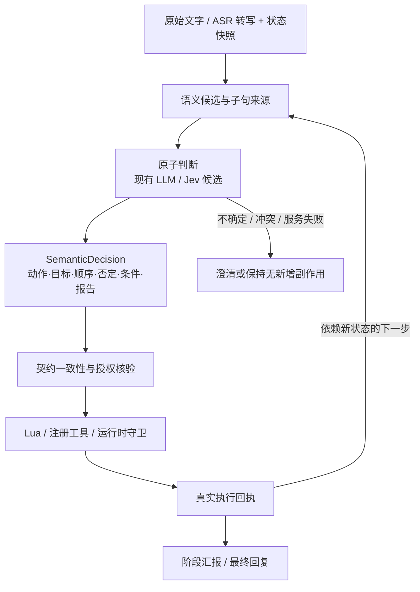

# 统一语义决策方案（待实现）

本页是下一阶段设计，不是已交付功能。Jev 尚未接入；当前仍使用公开源码中的模型路由与选择分类规则。

## 从哪里改

最近的关键失败发生在理解与路由：前半句“选中蓝球”明确要求执行，后半句“解释选择结果”要求汇报，整个请求却被判为讨论。持续追加局部关键词不足以消除多个组件对同一句输入的重复解释。

建议形成一份带原文来源与版本的 `SemanticDecision`，由下游共同消费。任务契约独立核验授权与一致性，不再静默改写用户意图；模型判断冲突时进入澄清或拒绝路径。

## 各层职责

| 层次 | 职责 |
|---|---|
| 输入快照 | 保留原始转写、输入来源、任务代次、选中上下文及状态版本 |
| 候选提取 | 提取动作与目标，标明原文跨度、顺序、引用、否定和条件作用域；不按逗号盲切 |
| 判断 | 判断是否有执行请求、是否是引用/评价、哪些动作被禁止、是否需要澄清；执行与报告可同时为真 |
| 统一决策 | 固化来源、目标槽、引用依据、约束、不确定性及判定版本，避免后层静默覆盖 |
| 确定性守卫 | 格式、授权、实体/句柄有效性、同帧绑定、新帧确认、可达性、资源、取消与迟到隔离 |
| 汇报 | 依据真实执行回执说明成功、失败、取消、拒绝及未执行项 |

## Jev 如何进入评测

Jev 在本方案中作为有类型判断的候选，评估事先定义的问题；候选提取、自由文本计划和 Lua 生成仍由现有语言模型承担。正式使用前核对官方接口与服务可用性。

先对同一份中文标注样本比较现有路由、统一 LLM 路由与 Jev 旁路判断。Jev 先记录意见，不控制实际动作；只有留出样本与真实闭环结果支持时才替换。置信度表示输出分布的确定程度，不是本项目正确率，阈值通过误执行代价和实测校准。

同一快照内的独立问题可批量评估；依赖新画面、执行回执或任务状态的问题等待新状态。超时、冲突和不确定都不能悄悄落回旧关键词执行。明确停止保留本地快速取消通道。

## 验收顺序

1. 建立小型开发集与独立留出集：执行后报告、纯讨论/引用、否定、自我纠正、条件顺序、代词歧义和“仅看不走”。
2. 统计误执行、漏执行、约束丢失、指代/顺序错误，以及时延和请求量；修改提示词不使用留出答案。
3. 在旁路比较后接入统一决策，先本地回放，再做小范围真实视觉动作复验。
4. 验证新帧选 A/B、复用 A、B 缺失停止、外部取消与迟到结果；真实、注入、首次、重试分列。

不同时扩张多相机观察、地图生成、绕圈和全量语言覆盖，先把语义到执行的主要错误稳定复现并消除。

## 官方参考

- [TypeSafe Introduction](https://docs.typesafe.ai/introduction)
- [Confidence](https://docs.typesafe.ai/confidence)

本项目尚未验证 Jev 在中文 ASR、引用/否定作用域及连续动作上的准确性、时延或账号可用性。
