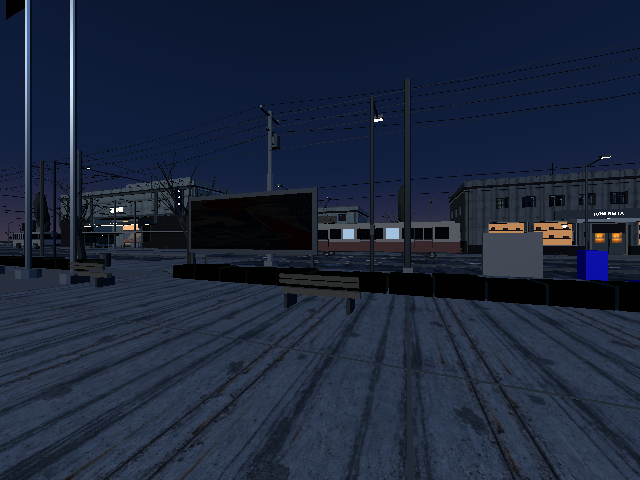
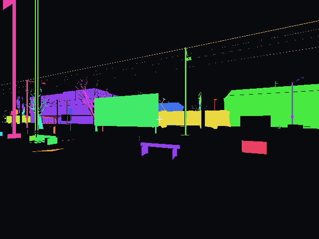
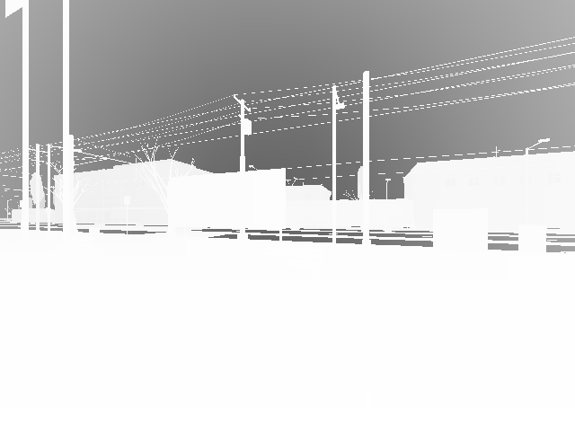

# 运行截图与来源索引

[项目首页](../README.md) · [策划案](../README.planning.md) · [当前验证边界](progress-2026-11-16.md)

本轮文档使用 **10 张真实录屏截帧、3 张历史同帧缓冲图，以及 4 张职责/流程解释图**。运行画面来自本地完整工程，源码仓库保持脱敏展示范围。

## 素材性质

- **2026-11-16 实录**：从原始视频裁出 Unity 游戏画面，原生输出 1516×848；未放大、未拼接状态、未添加成功 UI。白盒、座椅、公交和对话是独立任务素材。
- **实际输入方式**：拍摄驱动把文字写入真实输入框并提交。语义、视觉、工具执行和 TTS 走项目实际链路；没有注入成功选择、预制任务契约或完成回执。这组素材不证明真人麦克风 ASR。
- **2026-11-11 缓冲图**：同一份受控采集的 RGB、ID 可视化和 depth 可视化；三张原始 PNG 不经缩放。它们解释视觉绑定机制，不构成新增模型准确率验证。
- **解释图**：根据现有代码与数据职责手绘的 SVG，明确区别于运行截图。

本次只复用已有素材，新增真实 LLM/TTS 调用为 0，没有重新启动 Unity 或更改场景。公开图片不会包含原始桌面、私人聊天、凭据或服务配置；完整录屏、音轨与运行记录在本地留存。

## 实录帧

原始 take 文件名和秒数用于本地复核，原视频不随源码发布。点击图片名称可查看原图。

| 图片 | 原始素材 / 秒 | 支持的观察 | 使用限制 |
|---|---|---|---|
| [社区场景总览](images/readme-20261116/world-hero.png) | `take_drive2.mp4 / 44.0` | 角色、场景、HUD 与正在执行的任务同屏 | 地图缩略图不适合证明锚点文字或路径细节 |
| [HUD 地图页](images/readme-20261116/world-navigation.png) | `take_drive2.mp4 / 47.0` | 真实地图页、分类筛选与 POI 图层 | 静帧不证明点选导航完成 |
| [白盒请求](images/readme-20261116/selection-input.png) | `take_sel2.mp4 / 29.0` | 选中左边红色立方体的原文输入 | 驱动提交；此时尚未完成定位 |
| [白盒确认结果](images/readme-20261116/selection-confirmed.png) | `take_sel2.mp4 / 38.0` | 同一请求的高亮、lab/red_cube、坐标与确认回执 | 不推导为任意目标或相似实例均能识别 |
| [目标缺失负例](images/readme-20261116/selection-negative.png) | `take_sel_pos.mp4 / 58.0` | 本次请求返回未找到 | 旧选择面板与顶部横幅残留；不能当本次成功，也不能仅凭静帧证明全程未移动 |
| [长椅坐下](images/readme-20261116/seat-seated.png) | `take_seat2.mp4 / 34.0` | 坐姿、座椅 ID 与 seated 回执同屏 | 不证明所有座椅适配或过渡无跳变 |
| [起身恢复](images/readme-20261116/seat-standing.png) | `take_seat2.mp4 / 76.0` | 同一段素材的起身与可步行状态 | 静帧不能证明之后路径完成 |
| [公交任务结果](images/readme-20261116/vehicle-result.png) | `take_drive2.mp4 / 89.0` | 五步真实回执；行驶约34.6m、停车和下车 | 具名任务；不证明视觉选中到驾驶，车内镜头仍有遮挡 |
| [对话与角色](images/readme-20261116/dialogue.png) | `take_talk.mp4 / 8.0` | 实际回复字幕与角色同屏 | TTS 播放需结合音轨；静帧不证明逐音素口型或字幕逐字对齐 |
| [第一人称过程](images/readme-20261116/eye-view.png) | `take_seat2.mp4 / 6.0` | Eye 视角的对准与确认中反馈 | 过程态，不作为成功确认 |

## 同帧缓冲

三张图共享来源组 `gen_002352/00_initial_frame`，来自 2026-11-11 的同一次 Eye 采集。RGB 是模型观察图；实例 ID 和深度由引擎使用，下面公开的是供人阅读的可视化。

| RGB | 实例 ID 可视化 | Depth 可视化 |
|---|---|---|
|  |  |  |

每张 640×480。它们证明相关数据产物存在；实体身份、是否符合自然语言和任务是否完成仍需各自验证。

## 解释图

| 图 | 用途 |
|---|---|
| [职责划分](images/readme-20261116/architecture.svg) | 现有模型、任务契约、Unity 工具与反馈的责任边界 |
| [视觉选择](images/readme-20261116/vision-loop.svg) | 旧帧绑定与转动后新帧确认 |
| [生命周期](images/readme-20261116/lifecycle.svg) | 行动与语音独立管理及取消代次 |
| [地图数据](images/readme-20261116/world-data.svg) | 资产、实体、碰撞、导航与接地的分工 |

## 核验范围

文件路径、来源时间、像素尺寸、哈希、同帧分组与文档链接经过检查。[公开图片清单](showcase-images.json)记录逐图来源与 SHA-256，不含本机绝对路径。

独立图审服务在先前检查中返回额度错误，本轮未重试。文件和来源核验不代替人工判断画面、字幕可读性、动作自然度或声画同步；这些表现项保留待人工查看。运行成功结论以实际回执及历史交接为依据，不以单张图代替整条任务验收。
